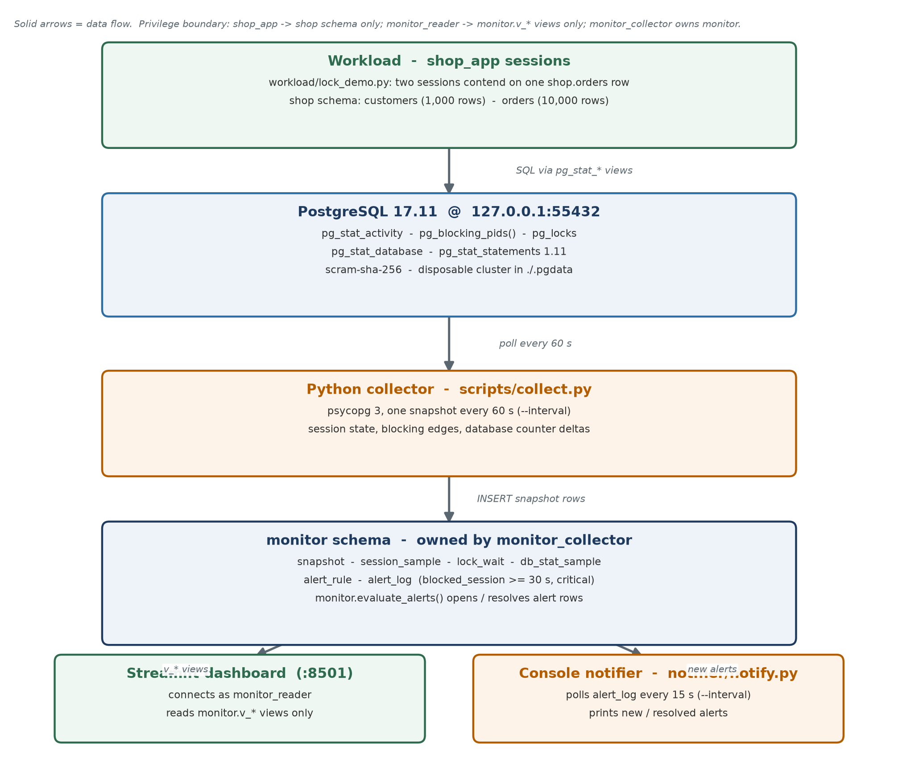

# PostgreSQL Database Monitoring Dashboard

**CSCE 4355 — Database Administration · Final Project**
Historical metrics collection, threshold-based alerting, and a read-only dashboard for a simulated
online store.

## 1. Purpose

PostgreSQL's statistics views (`pg_stat_activity`, `pg_stat_database`, `pg_locks`,
`pg_stat_statements`) describe *now*, or a running total since the last reset. A DBA who arrives
after a slowdown cannot see what happened, when it started, or which sessions were responsible.
This project stores periodic observations in a `monitor` schema, detects a blocked-session
condition from the stored history, records the alert, reports it to a console notifier, and exposes
the history to a read-only dashboard role.

The delivered demonstration is deliberately narrow: **one DBA workflow, end to end** — a simulated
shop develops lock contention, the collector preserves who blocked whom, the rule fires, the console
notifier reports it, the dashboard shows the same event, the alert resolves after the lock clears.
The proposal's six alert rules, six shop tables, Grafana dashboard, Docker Compose stack and
`pg_cron` scheduling are **not** all delivered; §10 states exactly what is and is not implemented.

### 1.1 Verified result (live run, 2026-11-22)

The pipeline was run end to end on `shopdb`; the evidence is committed under `docs/results/live/`.
One alert opened and resolved:

| Moment | Source |
|---|---|
| Lock injected: PID 35164 waits on PID 42028 (`lock_demo_blocker`, idle in transaction) | `docs/results/live/lock_demo.log` |
| Wait start stored by the collector (`first_seen_at`) | `docs/results/live/alert_sql.txt` |
| Threshold crossed (`eligible_at`, +30 s) | `docs/results/live/alert_sql.txt` |
| Alert 1 fired, `observed_seconds` 51.8 | `docs/results/live/alert_sql.txt` |
| Notifier printed the alert | `docs/results/live/notifier_console.log` |
| Lock released | `docs/results/live/lock_demo.log` |
| Alert resolved, open alerts 0 | `docs/results/live/alert_sql.txt` |

Detection took 51.8 s against the proposal's 120 s (two-interval) target and resolution took 21.8 s
after release; no duplicate alert was opened while the wait persisted. The dashboard showed the same
alert ID and PIDs (`docs/results/lock-dashboard.png`, embedded as Figure 2 in the report).

Two further rules were verified in a separate live run on `shopdb_t5`: `idle_in_transaction` fired
60.605 s after the session became idle in transaction (0.604 s after eligibility) and resolved
20.602 s after the session ended; `long_active_query` fired 60.562 s after the query started
(0.561 s after eligibility) and resolved 20.555 s after the session ended. Both runs used a 30 s
collector cadence, not the 60 s default, so the timing is sample-bounded as disclosed in
`docs/results/t5_extra_rules_live.txt`. Three of the six proposed rules are now verified live.

A fresh-clone reproduction was run by the team's automated tooling — **self-tested by team tooling,
not independently reproduced by a teammate**. It reproduced T1–T7 end to end (cluster, schema,
18/18 tests, alert fire and resolve, notifier, dashboard health, cleanup), but only after three
README gaps were worked around. As first written, `start_cluster.sh` failed because its `mktemp`
password file landed on an MSYS `/tmp` path that native `initdb` could not read, and it fixed
`PGPORT` before sourcing `.env`; `pytest tests -v` also failed because §6 did not name the test
databases. The script has since been fixed to source `.env` before computing the port and to create
the password file inside the project directory, and §6 now lists the test databases and the
ambient-`PG*` caveat. Details and the initial failure output: `docs/results/repro_smoke.txt`.

## 2. Architecture



```
workload (shop_app)  ->  PostgreSQL 17.11 statistics views  ->  Python collector (60 s)
                     ->  monitor history tables + alert_log  ->  monitor.v_* views  ->  Streamlit
                                                             ->  console notifier (alert_log)
```

| Component | Implementation | Notes |
|---|---|---|
| DBMS | PostgreSQL **17.11**, disposable non-admin cluster in `./.pgdata` on `127.0.0.1:55432` | Proposal specified PostgreSQL 16 in Docker; see §10 |
| Statistics source | `pg_stat_activity`, `pg_blocking_pids()`, `pg_locks`, `pg_stat_database`, `pg_stat_statements` 1.11 | `pg_stat_statements` preloaded at cluster init |
| Collection | `scripts/collect.py`, psycopg 3, one snapshot every 60 s | Python scheduler loop; replaces the proposed `pg_cron` job |
| History / alerting | `monitor` schema: `snapshot`, `session_sample`, `lock_wait`, `db_stat_sample`, `alert_rule`, `alert_log`; `monitor.evaluate_alerts()` | Owned by `monitor_collector` |
| Dashboard | `dashboard/app.py`, Streamlit on port 8501 | Connects as `monitor_reader`; reads `monitor.v_*` views only |
| Notifier | `notifier/notify.py`, console output, 15 s poll of `alert_log` | No email/SMS |
| Report build | `docs/report/build_report.py` (`report.md` → `.docx`) | Requires `python-docx` |

Least privilege is enforced by three login roles: `shop_app` (DML on `shop` only), `monitor_collector`
(owns `monitor`, member of `pg_read_all_stats`), `monitor_reader` (`SELECT` on `monitor.v_*` only).
No component connects as a superuser except the one-time setup scripts.

## 3. Prerequisites

Verified environment: **Windows 11**, Git Bash (the scripts are bash, not PowerShell), PostgreSQL 17
binaries, Python 3.12, `uv`. The local environment used Python 3.12.10, psycopg 3.3.9 and
Streamlit 1.67.0; versions other than PostgreSQL's are not part of the reproduction contract.

| Requirement | Exact expectation |
|---|---|
| OS / shell | Windows 11 with Git Bash (`bash`, `mktemp`, `sed`). Commands below are run from the repository root in Git Bash. |
| PostgreSQL 17 binaries | `C:/Program Files/PostgreSQL/17/bin` containing `initdb.exe`, `pg_ctl.exe`, `pg_isready.exe`, `psql.exe`. The scripts prepend this directory to `PATH` themselves. Override with `PGBIN=...` if installed elsewhere. |
| Python | 3.12, virtual environment at `.venv` |
| `uv` | Used to create the venv and install packages |
| Ports | `55432` (project cluster) and `8501` (dashboard) free. The existing Windows PostgreSQL service on `5432` is never touched. |
| Privileges | **No administrator rights required.** The cluster lives under `./.pgdata` and runs as the current user. |
| Docker | **Not required and not used.** Docker was not installed on the build machine. |

Create the environment and install the runtime dependencies:

```bash
uv venv .venv --python 3.12
uv pip install --python .venv/Scripts/python.exe "psycopg[binary]" streamlit pytest
# report tooling only (docs/report/build_report.py)
uv pip install --python .venv/Scripts/python.exe python-docx matplotlib
```

## 4. Setup

### 4.1 Configure `.env`

`.env` is gitignored and is the only place credentials exist.

```bash
cp .env.example .env
```

Edit `.env` and replace **every** `change-me` value with a local random string. At minimum
`PG_SUPERUSER_PASSWORD` must be set: `scripts/start_cluster.sh` passes it to `initdb` through a
temporary password file.

| Variable | Meaning |
|---|---|
| `PGHOST`, `PGPORT`, `PGDATABASE` | `127.0.0.1`, `55432`, `shopdb` |
| `PG_SUPERUSER` / `PG_SUPERUSER_PASSWORD` | Cluster superuser created by `initdb` (`postgres`) |
| `SHOP_APP_PASSWORD` | Password for the application role |
| `MONITOR_COLLECTOR_PASSWORD` | Password for the collector role |
| `MONITOR_READER_PASSWORD` | Password for the dashboard role |
| `COLLECT_INTERVAL_SECONDS` | Default collection interval (60) |

The cluster's listening port is taken from `.env` at initialization time: `scripts/start_cluster.sh`
sources `.env` before it computes the port. **To use a different port, set `PGPORT` in `.env`
before the first `scripts/start_cluster.sh`** — no exported shell variable is required. Changing
`.env` after the cluster has been initialized does not move the existing cluster; stop it, delete
`.pgdata`, and start again (or edit `port` in `.pgdata/postgresql.conf`).

`scripts/setup_db.sh` can also generate a `.env` with random passwords when none exists, but
`scripts/start_cluster.sh` needs `.env` *before* it can initialize the cluster, so the copy above is
the reliable first-run path. Existing `.env` files are never overwritten.

### 4.2 Start the cluster

```bash
scripts/start_cluster.sh
```

Do **not** pipe the script through `tee` (`scripts/start_cluster.sh | tee start.log`): the started
server inherits the pipe and the command never returns in Git Bash. Redirect the output instead:
`scripts/start_cluster.sh > start.log 2>&1`.

First run performs `initdb` into `./.pgdata` with `--auth=scram-sha-256`, appends the project
settings to `postgresql.conf` (`listen_addresses = '127.0.0.1'`, `port = 55432`,
`shared_preload_libraries = 'pg_stat_statements'`, `pg_stat_statements.track = all`,
`track_activity_query_size = 2048`, `log_lock_waits = on`, `deadlock_timeout = 1s`) and starts the
server. Later runs only start it. Success ends with `pg_isready` reporting
`127.0.0.1:55432 - accepting connections`.

### 4.3 Create the database, roles and schema

```bash
scripts/setup_db.sh
```

This applies, in order: `sql/00_roles.sql` (roles + database), `sql/01_shop.sql` (shop schema and
deterministic seed), `sql/10_monitor.sql` (monitor history, rule, views, grants),
`sql/20_alerts.sql` (blocked-session rule) and `sql/21_extra_rules.sql` (idle-in-transaction and
long-running-query rules) when present. It finishes by printing the server version, the
`pg_stat_statements` version, and the seeded row counts. Expected on this build:
`server=17.11`, `pg_stat_statements=1.11`, `customers=1000`, `orders=10000`
(captured in `docs/results/t1_setup.txt`).

The script is safe to re-run: roles and the database are created only when missing, `sql/01_shop.sql`
drops and rebuilds the two shop tables, and the monitor objects use `IF NOT EXISTS`.

> `setup_db.sh` must run **after** the cluster is accepting connections. It connects with `psql` as
> the superuser, so `PG_SUPERUSER_PASSWORD` in `.env` must match the password used at `initdb` time.

## 5. Running the system

All commands run from the repository root in Git Bash. Four terminals are enough for the full
scenario.

### 5.1 Collector (60 s snapshots)

```bash
.venv/Scripts/python.exe scripts/collect.py --interval 60
```

Writes one `monitor.snapshot` row per cycle plus the per-session, lock-edge and database-counter
rows for that snapshot, then evaluates the alert rules. Leave it running.

### 5.2 Console notifier (15 s poll)

```bash
.venv/Scripts/python.exe notifier/notify.py --interval 15
```

Prints newly opened and resolved alerts read from `monitor.alert_log` and stamps `notified_at` /
`resolve_notified_at`, so notification delay is recorded rather than assumed. It does not change
alert state.

### 5.3 Dashboard (port 8501)

```bash
.venv/Scripts/python.exe -m streamlit run dashboard/app.py --server.port 8501
```

Then open <http://127.0.0.1:8501>. The dashboard connects as `monitor_reader`; it can only read the
`monitor.v_*` views. `streamlit run ...` works identically if the venv is activated first.

### 5.4 Lock-contention scenario

Run **after** the collector has taken at least one snapshot. With `--hold 150` the blocker is held
across at least two 60 s samples, which is what makes the 30 s threshold observable.

```bash
.venv/Scripts/python.exe workload/lock_demo.py --hold 150
```

Expected sequence: two `shop_app` sessions touch the same `shop.orders` row; one blocks; the
collector records the `(blocked_pid, blocker_pid)` edge in `monitor.lock_wait`; once the observed
wait reaches 30 s, `monitor.evaluate_alerts()` opens one `blocked_session` alert (severity
`critical`); the notifier prints it once; the dashboard shows the same PIDs; after the demo releases
the lock, a later clean snapshot resolves the alert. Each step of that sequence is captured for the
2026-11-22 run in §1.1, and the per-step artifacts are listed in §7.

## 6. Tests

The suite runs against three disposable databases. Create them once on a freshly started cluster:

```bash
bash scripts/setup_db.sh shopdb_t2   # tests/conftest.py — capture + privilege tests
bash scripts/setup_db.sh shopdb_t3   # tests/test_alert.py
bash scripts/setup_db.sh shopdb_t5   # tests/test_extra_rules.py
```

Run the suite from a shell with **no ambient `PG*` variables** set (or with the `.env` values
exported). `scripts/dbconf.py` lets any `PG*` variable in the caller's environment override the
corresponding `.env` value, so stale credentials in the shell can produce
`password authentication failed` while `psql` with the same `.env` still connects:

```bash
env -u PGPASSWORD -u PG_SUPERUSER -u PGHOST -u PGPORT -u PGDATABASE \
    -u PG_SUPERUSER_PASSWORD -u SHOP_APP_PASSWORD \
    -u MONITOR_COLLECTOR_PASSWORD -u MONITOR_READER_PASSWORD \
    .venv/Scripts/python.exe -m pytest tests -v
```

The suite is four files and 29 tests: `tests/test_capture.py` (3 tests: unattended snapshots with
distinct timestamps, lock-edge destroyed-but-kept history, delta correctness),
`tests/test_privileges.py` (6 tests: reader allowed on every view, reader denied on base tables and
`shop`, app denied on `monitor`), `tests/test_alert.py` (9 tests: threshold eligibility, one open
alert per wait, resolution, PID reuse, the live contention path and the notifier) and
`tests/test_extra_rules.py` (11 tests: both thresholds below/at the boundary, one open alert per
episode, resolution, collector exclusion, PID reuse, and a live session that opens and resolves each
rule). The full suite on freshly dropped and recreated test databases is `29 passed in 22.18s`
(`docs/results/final_pytest.txt`, 22:06:53 CST). The per-lane runs are `11 passed in 18.41s`
(`tests/test_extra_rules.py`) and `9 passed in 3.47s` (`tests/test_alert.py`) in
`docs/results/t5_extra_rules_pytest.txt`; `9 passed in 0.68s` (`docs/results/t2_pytest.txt`, capture
+ privileges) and `9 passed in 3.28s` (`docs/results/t3_pytest.txt`, alert).

## 7. Evidence index

Evidence lives in `docs/results/`; `docs/results/live/` holds the artifacts of the 2026-11-22
end-to-end run. Every result quoted in this README and in the report is read from one of these
captured files.

| Artifact | What it shows | Status |
|---|---|---|
| `docs/results/t1_setup.txt` | Server `17.11`, `pg_stat_statements` `1.11`, seeded counts `1000` / `10000`, `shop_app` login from a fresh client | Captured 2026-11-22 21:24 CST |
| `docs/results/t2_collector_run.txt` | Unattended `--count 2` loop 60 s apart on `shopdb_t2`, `NULL` first deltas then non-negative deltas, a lock edge preserved after release | Captured 21:33–21:34 CST |
| `docs/results/t2_pytest.txt` | Capture + privilege suite: `9 passed in 0.68s` | Captured |
| `docs/results/t3_pytest.txt` | Alert suite: `9 passed in 3.28s` | Captured |
| `docs/results/t3_notifier_sample.txt` | Earlier fire/resolve sample on `shopdb_t3` (PIDs 2892 / 15256), notifier prints each transition once | Captured |
| `docs/results/t4_boot.txt` | Dashboard boot, `HTTP 200`, `_stcore/health ok`, rendered panels, 15 s auto-refresh, stale-collector banner; dev fixtures in `shopdb_t4` | Captured |
| `docs/results/live/alert_sql.txt` | alert 1 row, lock history, snapshot gaps and timing analysis, queried as `monitor_reader` | Captured 21:46:10 CST |
| `docs/results/live/collector.log` | Four snapshots with `lock_edges`, `alerts_opened`, `alerts_resolved` per cycle | Captured |
| `docs/results/live/notifier_console.log` | The `[ALERT FIRED]` and `[ALERT RESOLVED]` lines for alert 1 | Captured |
| `docs/results/live/lock_demo.log`, `lock_demo_events.jsonl` | Injection and release times, blocker/waiter PIDs, held row | Captured |
| `docs/results/lock-dashboard.png` | Streamlit dashboard at 21:43:59, alert 1 open, PIDs 35164 / 42028, snapshot #2 | Captured (Figure 2) |
| `docs/results/lock-dashboard-open-2.png` | Same page at 21:44:43, snapshot #3, `observed_seconds` 111.8, still open | Captured |
| `docs/results/lock-dashboard-resolved.png` | Same page at 21:45:47, snapshot #4, open alerts 0, resolved 1; the alert grid text did not paint in this capture | Captured |
| `docs/results/live/dashboard_open_alert.html`, `dashboard_resolved.html` | Static reader-view renders of the same rows (alert 1, 35164 / 42028, fired 21:43:25, resolved 21:45:25) | Captured |
| `docs/results/live/integration_pytest_summary.txt` | `9 passed in 0.48s` and `9 passed in 3.13s` on freshly rebuilt `shopdb_t2` / `shopdb_t3` | Captured |
| `docs/results/repro_smoke.txt` | Fresh-clone reproduction of T1–T7 from the README: cluster, schema, 18/18 tests, alert fired for 23896 blocked by 19700 at 32.2 s and resolved, notifier, dashboard health, cleanup | Captured 2026-11-22 21:48–22:01 CST; PASS after the documented fixes — self-tested by team tooling, not a teammate |
| `docs/results/t5_extra_rules_live.txt` | `idle_in_transaction` and `long_active_query`: one alert each, fired 60.605 s / 60.562 s after injection and resolved 20.602 s / 20.555 s after the sessions ended, at a 30 s cadence | Captured 21:54–21:59 CST |
| `docs/results/t5_extra_rules_pytest.txt` | `tests/test_extra_rules.py` `11 passed in 18.41s`; `tests/test_alert.py` `9 passed in 3.47s` after the change | Captured 21:59:43 CST |
| `docs/results/final_pytest.txt` | Full suite on freshly dropped and recreated test databases: `29 passed in 22.18s` | Captured 22:06:53 CST |
| `docs/results/pgbench_overhead.txt` | Three collector-off / three collector-on `pgbench` runs | Not measured |

## 8. Repository structure

```
Final_Project/
├── README.md                     this file
├── .env.example                  template for local credentials (copy to .env)
├── .gitignore                    excludes .env, .pgdata/, .venv/, caches
├── scripts/
│   ├── start_cluster.sh          initdb (first run) + start/stop disposable PG17 cluster
│   ├── setup_db.sh               roles, database, shop seed, monitor schema, summary
│   ├── collect.py                60 s snapshot collector + alert evaluation
│   └── dbconf.py                 .env-driven psycopg 3 connection helper
├── sql/
│   ├── 00_roles.sql              shop_app / monitor_collector / monitor_reader, database, grants
│   ├── 01_shop.sql               shop.customers, shop.orders, orders_customer_id_idx, seed
│   ├── 10_monitor.sql            history tables, alert_rule, alert_log, views, reader grants
│   ├── 20_alerts.sql             monitor.evaluate_alerts() — blocked_session rule
│   └── 21_extra_rules.sql        idle_in_transaction and long_active_query rules
├── workload/
│   └── lock_demo.py              two-session row-lock contention generator
├── notifier/
│   └── notify.py                 console notifier for alert_log
├── dashboard/
│   └── app.py                    Streamlit dashboard (monitor_reader)
├── tests/                        pytest suite (29 tests)
├── docs/
│   ├── results/                  captured evidence (see §7)
│   │   ├── live/                 collector/notifier/demo logs, alert SQL, dashboard renders
│   │   └── lock-dashboard*.png   Streamlit captures of the live alert
│   └── report/
│       ├── report.md             technical report source
│       ├── build_report.py       report.md -> TeamName_Final_Project_Report.docx
│       └── figures/              architecture.png, dashboard.png (Figure 2)
└── Tonight_Build_Plan.md         build plan and scope decisions
```

## 9. Status of alert rules

`blocked_session`, `idle_in_transaction` and `long_active_query` are verified live in this build —
3 of the 6 proposed rules. A rule is called **verified** only when a captured run shows the alert
opening and resolving.

| Rule (proposal §8.2) | Threshold | Severity | Status |
|---|---|---|---|
| Blocked sessions | wait ≥ 30 s | critical | **Verified (live)** — alert 1 opened 21:43:25.214 and resolved 21:45:25.208 (`docs/results/live/alert_sql.txt`) |
| Idle in transaction | > 60 s | warning | **Verified (live, 30 s cadence)** — alert 1 opened 21:55:05.198, 60.605 s after injection (0.604 s after eligibility), resolved 21:56:05.192, 20.602 s after the session ended (`docs/results/t5_extra_rules_live.txt`) |
| Long-running query | active > 60 s | warning | **Verified (live, 30 s cadence)** — alert 2 opened 21:57:44.958, 60.562 s after the query started (0.561 s after eligibility), resolved 21:58:44.953, 20.555 s after the session ended (same file) |
| Connection saturation | > 80 % of `max_connections` | critical | Not implemented |
| Low cache hit ratio | < 95 % over 5 min | warning | Not implemented |
| Table bloat risk | dead tuples > 20 % of live tuples | info | Not implemented |

The two extra rules are implemented in `sql/21_extra_rules.sql` as
`monitor.evaluate_extra_rules(snapshot_id)`, called from `monitor.evaluate_alerts()` when the
function exists. Both use a **60 s** threshold and `warning` severity; both were measured with a
collector `--interval 30` (not the 60 s default) so the 100 s demonstrations fit, which bounds
detection latency to the sampling grid — the fire delay after eligibility was 0.604 s and 0.561 s
only because eligibility happened to fall just before a scheduled sample. For these rules
`blocker_pid` repeats `blocked_pid`, because `alert_log.blocker_pid` is `NOT NULL` and neither
condition has a blocker. Configuration rows alone do not count as detection: `monitor.alert_rule`
holding a row is not evidence that the rule fired.

## 10. Implementation status and limitations

Disclosed deviations from the approved proposal (all of them also appear in report §8):

| Area | Proposed | Delivered |
|---|---|---|
| DBMS / provisioning | PostgreSQL 16 in Docker Compose | PostgreSQL **17.11**, disposable non-admin local cluster (Docker not installed) |
| Scheduler | `pg_cron` in-database job | Python scheduler loop in `scripts/collect.py` |
| Dashboard | Provisioned Grafana | Streamlit app on port 8501 |
| Shop schema | 6 tables, ~100k customers / ~1M orders | 2 tables (`customers`, `orders`), **1,000 / 10,000** deterministic rows |
| History | Session, statement, table, index, lock and database history; hourly rollup; retention | Session, lock-edge and database-counter history; no statement/table/index history, no rollup, no purge job |
| Alert rules | 6 | 3 of 6 verified live (`blocked_session`, `idle_in_transaction`, `long_active_query`); saturation, cache ratio and bloat not implemented |
| Overhead | `< 5 %` pgbench impact | **Not measured** |
| Recording | Required video | **Outstanding** |

Further limitations:

- Sampling, not tracing: events shorter than one collection interval can fall between snapshots.
  The lock demo holds for 150 s precisely to avoid that; the limitation remains for real workloads.
- `resolved_at` is the first clean sample, not the release instant, so it can lag the real recovery
  by up to one interval (21.8 s in the captured run). `fired_at` is likewise the first sample at or
  above the threshold, not the instant the threshold was crossed.
- An open alert is keyed on `(rule_name, blocked_pid)`. A later wait by the same PID is treated as a
  new episode via its wait start time; a different backend that reused the PID within the same
  wait-start window would be attributed to the existing alert.
- When a backend waits on several blockers the alert names the lowest blocker PID and the longest
  observed wait; the other edges stay in `monitor.lock_wait` but not in the alert row.
- `pg_stat_statements` is available and preloaded, but no statement-level history is stored.
- Deltas in `monitor.db_stat_sample` are `NULL` on the first sample and after `pg_stat_reset`; they
  are never negative, and no rate is claimed for those intervals.
- The cluster is single-node, local-only, without TLS, replication or backups; it is a disposable
  teaching environment, not a production deployment. Deleting `./.pgdata` destroys all history.
- Alerting is console-only; there is no email, paging or deduplication across restarts beyond the
  `alert_log_one_open` partial unique index.
- The dashboard is read-only by construction (role grants), but its panels and refresh behavior are
  only as good as the captured evidence in §7.

## 11. Report build

The technical report is written in Markdown and converted to Word:

```bash
.venv/Scripts/python.exe docs/report/build_report.py
# -> docs/report/TeamName_Final_Project_Report.docx

# PDF, when LibreOffice is installed (this build used LibreOffice at the default path):
"/c/Program Files/LibreOffice/program/soffice.exe" --headless --convert-to pdf \
  --outdir docs/report docs/report/TeamName_Final_Project_Report.docx
```

The builder supports headings, paragraphs, bullet/numbered lists, pipe tables, inline bold/italic/
code, fenced code blocks, `<!-- pagebreak -->`, a `<!-- titlepage:start -->` / `<!-- titlepage:end -->`
block, and `` images, which are embedded at 6.5 in width with an auto-numbered
caption. Missing image files are reported as warnings and rendered as a visible placeholder rather
than silently dropped.

Figure 2 in the report is `docs/report/figures/dashboard.png`, cropped from
`docs/results/lock-dashboard.png` to the header, alert and blocker panels; the full-page capture is
kept unchanged under `docs/results/`.

The team name is not fixed yet, so the output keeps the `TeamName_` prefix required by the submission
guidelines. Rename the file to `<TeamName>_Final_Project_Report.docx` and `.pdf` before submitting.

## 12. Cleanup

```bash
scripts/start_cluster.sh stop     # pg_ctl -m fast stop
rm -rf .pgdata                    # destroys the database and all monitor history
```

Stop the collector, notifier and Streamlit with `Ctrl+C` first. Deleting `.pgdata` is the documented
reset: the next `scripts/start_cluster.sh` recreates an empty cluster and `scripts/setup_db.sh`
rebuilds the schema and seed. `.env` is intentionally kept so the same passwords are reused.

## 13. Security notes

- No credentials are committed: `.env` is gitignored, `.env.example` contains only `change-me`.
- SQL scripts take passwords as `psql` variables; no password literal appears in `sql/`.
- `monitor.session_sample` stores only a 60-character statement excerpt and no credentials.
- `pg_stat_activity` access is granted through `pg_read_all_stats` to the collector only.
- The cluster listens on `127.0.0.1` only, with `scram-sha-256` authentication.
