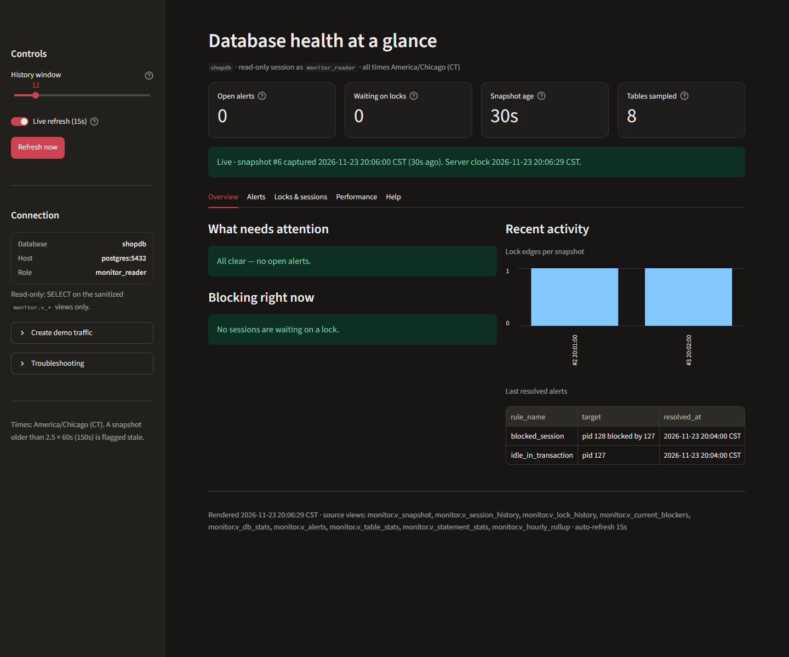

<!-- titlepage:start -->
# PostgreSQL Database Monitoring Dashboard
## Historical Metrics, Threshold Alerting, and a Read-Only Dashboard

CSCE 4355 — Database Administration

Final Project Report

Quan Nguyen · Dustin Dowell · Zach Riggle

November 23, 2026
<!-- titlepage:end -->

<!-- pagebreak -->

# Executive Summary

PostgreSQL's statistics views describe the present moment or a cumulative total since the last
reset. A database administrator who is called after a slowdown has already lost the evidence: which
session blocked which, when the wait began, and whether the condition cleared. This project closes
that gap for a small simulated online store by storing periodic observations of the server in a
dedicated `monitor` schema, evaluating threshold rules against that stored history, recording the
resulting alerts, reporting them through a console notifier, and exposing the history to a read-only
dashboard role.

The delivered system is a one-command Docker Compose stack. A `postgres` container runs
PostgreSQL 16.16 with `pg_cron` 1.6 and `pg_stat_statements` 1.10; it holds a six-table `shop`
schema and an eleven-table `monitor` schema with historical snapshots, sessions, lock waits,
database counters, table and statement statistics, alert rules and alert rows. `pg_cron` calls
`monitor.capture_snapshot()` every minute. That function writes one snapshot and its detail rows,
then evaluates all six configured rules in the same transaction: `blocked_session` (30 s,
critical), `idle_in_transaction` (60 s), `long_active_query` (60 s), `connection_saturation`
(0.80 of `max_connections`), `cache_hit_ratio` (0.90 over five minutes) and `dead_tuple_risk`
(1,000 dead tuples and 0.20 of live plus dead). A Streamlit container connects as `monitor_reader`
and can read only the twelve sanitized `monitor.v_*` views; a notifier container polls
`monitor.alert_log` every 30 seconds and stamps `notified_at` and `resolve_notified_at`.

Two evidence tracks are kept separate in this report. The **current PG16.16 Docker demonstration**
was run on the evening of 2026-11-23 CST (2026-11-24 UTC). The demo workload held a row lock for
120 seconds. Two alerts were recorded:
`blocked_session` on the waiting session (PID 128) and `idle_in_transaction` on the blocker (PID
127). Both fired at 02:02:00.005 UTC, 79.2 s after the lock was injected and 49.2 s after the
blocked-session threshold became eligible, and both resolved at 02:04:00.007 UTC, 79.1 s after the
lock was released. The notifier stamped delivery 27.9 s after firing and 24.2 s after resolution.
The dashboard was captured while both alerts were open and after they resolved. At capture time
the stack held 135 snapshots from 02:00 to 04:15 UTC with one 120-second gap and no open alerts.

The **archived PostgreSQL 17.11 local-cluster run** is a separate, earlier reference run, not the
current stack. It produced the 51.8 s blocked-session detection and 21.8 s resolution reported in
earlier drafts, the 29-test suite result, the six-rule fire/resolve evidence for rules the 120-second
demo does not trigger, and the `pgbench` overhead and missing-index measurements. Those results are
labelled archived throughout; they are not presented as PostgreSQL 16 Docker measurements. The
current stack was also tested with the 50-test suite: `50 passed in 24.43 s` on a brand-new
PostgreSQL 16.16 Docker volume at 22:41 CST on 2026-11-23 (04:41 UTC on 2026-11-24), with no
`pg_stat_statements_reset()` (`docs/results/live/pg16_fresh_test_suite.txt`). An earlier in-container
run failed one test (49 passed) and passed `50 in 23.66 s` only after a statistics reset; that
sequence is retained as a historical test-environment caveat, not a prerequisite for the current
suite.

The submission is not complete. The recorded demonstration is outstanding; Zach Riggle's
contribution row remains pending because no committed work product was found; the local Docker-app
changes are uncommitted and the GitHub remote is behind the local checkout. The report discloses
these gaps rather than implying that they are closed.

# 1. Introduction & Problem

## 1.1 The historical monitoring gap

PostgreSQL's cumulative statistics system answers "what is happening now" and "what has happened in
total". `pg_stat_activity` shows the current state of every backend, `pg_locks` and
`pg_blocking_pids()` show current lock waits, `pg_stat_database` accumulates counters since the last
statistics reset, and `pg_stat_statements` aggregates statement execution across the instance. None
of these views retains a timeline. A DBA who looks at them after users complain sees the aftermath,
not the incident: the blocking session has usually finished, the counters have moved on, and the
wait that lasted two minutes is invisible.

The practical consequences are familiar: connection exhaustion, long-running or blocked queries,
sessions left idle inside open transactions, a falling buffer-cache hit ratio, unused or missing
indexes, and growing dead-tuple counts are discovered late, when they have already affected users.
Without stored history there is no baseline to compare against, and without threshold evaluation
there is no early warning.

## 1.2 Objective

The project builds a working, reproducible monitoring loop for a single PostgreSQL instance running
a simulated online store:

1. Capture session, lock, database, table and statement observations on a fixed schedule and store
   them as history rather than exposing only the live views.
2. Detect blocked sessions, idle transactions and long-running statements from that stored history
   using explicit, configurable thresholds, and record when each condition became eligible, when
   the alert fired, and when it resolved.
3. Preserve *who blocked whom* — the `(blocked_pid, blocker_pid)` relationship — so an incident can
   be reconstructed after the fact.
4. Add ratio-based checks for connection saturation, buffer-cache hit ratio and dead-tuple risk,
   using the same alert lifecycle.
5. Report new and resolved alerts through a notifier and display the history through a read-only
   dashboard role.
6. Enforce least privilege with three roles, and make the whole demonstration reproducible with one
   Compose command on a disposable, non-administrator environment.

## 1.3 Final scope

The final scope is one complete DBA workflow, packaged as the proposal's Docker Compose environment
rather than the earlier local-cluster fallback. The six-table `shop` schema provides the workload
surface; six rules are implemented and enabled; `pg_cron` supplies the in-database scheduler; and
the Streamlit dashboard and console notifier ship as Compose services. The approved proposal also
asked for Grafana, roughly 100,000 customers and 1,000,000 orders, and a recorded demonstration.
Grafana remains an optional, unprovisioned Compose profile; the seed is 1,000 customers and 10,000
orders by default; and the video is outstanding. Section 8 states each gap.

The current 120-second demo naturally triggers two rules: `blocked_session` for the waiter and
`idle_in_transaction` for the blocker. The other four rules are configured and are evaluated on
every snapshot, but they need conditions the demo does not create. Their fire/resolve evidence comes
from archived PostgreSQL 17 local-cluster runs and is labelled as such in Sections 5–7. That
distinction is deliberate: a configured rule is not the same as an observed alert, and an archived
measurement is not a measurement of the current container.

# 2. System / Database Architecture

![Figure 1: Delivered Docker Compose architecture. The operator reaches Streamlit over HTTP on loopback (127.0.0.1:8501, no TLS). The demo workload issues SQL as shop_app. Inside the postgres container, pg_cron runs monitor.capture_snapshot() every 60 seconds; the function writes history and evaluates all six rules. The dashboard connects directly to PostgreSQL as monitor_reader and can SELECT only from the twelve monitor.v_* views. The notifier connects directly as monitor_collector, polls monitor.alert_log every 30 seconds and stamps notified_at / resolve_notified_at. There is no dashboard-to-notifier path.](figures/architecture_docker.png)

Figure 1 shows the deployed components. The `demo` service is an on-demand workload, not a
long-running service: `docker compose run --rm demo` starts two `shop_app` sessions that contend on
one row and holds the lock for 120 seconds. The `postgres` service is the only component with write
access to the data. Its `pg_cron` background worker calls `monitor.capture_snapshot()` once a minute
as `monitor_collector`. The function stores the snapshot, session, lock, counter, table and statement
rows, then calls `monitor.evaluate_alerts()`, `monitor.evaluate_extra_rules()` and
`monitor.evaluate_more_rules()` in that order, still inside the snapshot transaction. The
`dashboard` service runs Streamlit as `monitor_reader`; every query goes through one of the twelve
`monitor.v_*` views, and the role has no `SELECT` on the base history tables or `shop`. The
`notifier` service connects separately as `monitor_collector`, reads `monitor.alert_log` with
`SELECT ... FOR UPDATE SKIP LOCKED`, prints new and resolved rows, and stamps `notified_at` and
`resolve_notified_at`. The two services never call each other; both connect directly to the
`postgres` service.

## 2.1 Components

Table 1: Implemented components and their responsibilities.

| Component | Technology | Responsibility |
|---|---|---|
| Database | PostgreSQL 16.16 (Debian 16.16-1.pgdg12+1) in the `postgres` container; host port `127.0.0.1:55432` | Hosts the `shop` and `monitor` schemas and all history |
| Extensions | `pg_cron` 1.6 and `pg_stat_statements` 1.10, both preloaded at server start | In-database scheduling; statement statistics |
| Scheduling | `pg_cron` with four active jobs | Capture every minute, purge daily, rollup refresh hourly, cron-log cleanup daily |
| Collector | `monitor.capture_snapshot()` in `sql/12_capture_snapshot.sql` (PL/pgSQL) | Writes one snapshot and its detail rows, then evaluates all six rules in the same transaction |
| Workload | `workload/lock_demo.py` (psycopg 3), Compose profile `demo` | Opens a blocker and a waiter on one `shop.customers` row (`customer_id = 42`) and holds the lock for 120 s |
| History | `monitor` schema, owned by `monitor_collector` | Eleven tables: snapshot, session, lock-wait, database-counter, statement, table-stat, index-stat, table-sample, statement-sample, rule and alert tables |
| Alert logic | `sql/20_alerts.sql`, `sql/21_extra_rules.sql`, `sql/22_more_rules.sql` | Six enabled rules; opens, extends and resolves alert rows |
| Notifier | `notifier/notify.py` in the shared app image | Polls `monitor.alert_log` every 30 s, prints transitions and stamps delivery |
| Dashboard | `dashboard/app.py`, Streamlit 1.67.0, port 8501 | Five read-only tabs over twelve `monitor.v_*` views as `monitor_reader` |
| Retention | `monitor.purge_old_snapshots(interval)` in `sql/13_purge.sql` | Deletes old snapshots but keeps alert-referenced snapshots and the newest baseline |
| Configuration | `.env` (gitignored) read by Compose and `scripts/dbconf.py` | Database name, host port, dashboard port and the four role passwords |

## 2.2 Deployment and testing environment

The stack runs on Windows 11 with Docker Engine 29.1.3 inside WSL 2 and Compose 2.40.3. The host
binds PostgreSQL to `127.0.0.1:55432` and the dashboard to `127.0.0.1:8501`; the services reach each
other over the Compose network as `postgres:5432`. No administrator rights are required on the
Windows host, and the pre-existing PostgreSQL service on port 5432 is not touched. Table 2 records
the versions read from the running containers.

Table 2: Software versions in the current Docker environment.

| Software | Version | How it was determined |
|---|---|---|
| PostgreSQL server | 16.16 (Debian 16.16-1.pgdg12+1) | `select version()` inside `pg-monitoring-postgres-1` (`docs/results/live/pg16_docker_verification.txt`) |
| `pg_cron` | 1.6 | `pg_extension.extversion`, same capture |
| `pg_stat_statements` | 1.10 | `pg_extension.extversion`, same capture |
| Docker Engine / Compose | 29.1.3 / 2.40.3 | `docker version` and `docker compose version` in WSL 2 |
| Application image | `python:3.13-slim` with Streamlit 1.67.0, psycopg 3.3.9, pandas 3.1.1 | Package versions read inside `pg-monitoring-dashboard-1` |
| Report build | Python 3.12.10, python-docx 1.2.0, matplotlib 3.11.2 | Project virtual environment on the host |

The PostgreSQL image builds on `postgres:16.4-bookworm` and installs the distribution's PostgreSQL 16
packages, including `postgresql-16-cron`; the running server reports 16.16 because the package was
current when the image was built. That is a reproducibility caveat, not a claim that the image is
pinned to 16.16: rebuilding after a package update can produce a different 16.x patch level. The
image tag and the server version actually observed are both stated rather than conflated.

## 2.3 Data flow and privilege boundaries

Each collection cycle is one transaction:

1. Insert a `monitor.snapshot` row with `clock_timestamp()`; its `snapshot_id` and `captured_at`
   identify every row written in that cycle.
2. Copy one row per client backend from `pg_stat_activity` into `monitor.session_sample`, including
   state, wait event, transaction and query start times, the `pg_blocking_pids()` array and a
   60-character statement excerpt.
3. Expand each non-empty blocking array into one `monitor.lock_wait` row per `(blocked, blocker)`
   pair, with both roles and application names, the blocker's state, `wait_started` and the observed
   wait in seconds.
4. Read `pg_stat_database` for the project database into `monitor.db_stat_sample`, computing deltas
   against the previous sample and storing `NULL` when no valid previous sample exists.
5. Store one `monitor.table_stats_history` row per user table, one `monitor.index_stats_history` row
   per user index, one `monitor.statement_history` row per statement (top 500 by total time) and the
   corresponding table and statement samples used by the ratio rules. Statement text is clipped and
   the collector skips anything that looks like a password literal.
6. Call `monitor.evaluate_alerts()`, then its chained `monitor.evaluate_extra_rules()` and
   `monitor.evaluate_more_rules()`, so alert state is derived from the rows just stored.

The privilege boundary is part of the architecture, not an afterthought: `shop_app` has no rights in
`monitor`; `monitor_collector` owns `monitor` and is a member of `pg_monitor` so it can see other
sessions; `monitor_reader` has `USAGE` on the schema and `SELECT` on the twelve `v_*` views only.
The dashboard therefore cannot read base tables, cannot read `shop`, and cannot write anything.

## 2.4 Startup, operation and reset

`bash scripts/start_dashboard.sh` is the one-command entry point. On first run it creates `.env` with
random role passwords, runs `docker compose up -d --build`, and polls
`http://127.0.0.1:8501/_stcore/health` until the dashboard answers. The stack has three long-running
services (`postgres`, `dashboard`, `notifier`) and two profiles: `demo` for the lock workload and
`grafana` for the optional Grafana container. `bash scripts/stop_dashboard.sh` stops the stack and
keeps the `pgdata` volume; adding `--reset` deletes the volume and all history.

On an empty volume, `docker/postgres/initdb/10_project_init.sh` applies `sql/00_roles.sql` against
the `postgres` database and every numbered `sql/[0-9][0-9]_*.sql` file against the project database
in name order. `pg_cron` is installed and the four jobs are scheduled by `sql/90_cron_jobs.sql`
only when `pg_cron` is preloaded and `cron.database_name` matches the current database, so a test
database built inside the same container does not receive its own capture job.

# 3. Database Design

## 3.1 The `shop` schema

The application schema has six tables with primary keys, foreign keys, check constraints, unique
constraints and supporting indexes. `sql/01_shop.sql` drops and recreates the tables, so the seed is
repeatable and deterministic.

Table 3: Tables and seed sizes in the `shop` schema, read from the running database.

| Table | Rows | Key constraints and purpose |
|---|---:|---|
| `shop.customers` | 1,000 | Primary key `customer_id`; unique `email`; balance `CHECK (balance >= 0)` |
| `shop.products` | 200 | Identity primary key; unique `sku`; `CHECK (unit_price >= 0)` |
| `shop.orders` | 10,000 | Primary key; FK to `customers`; status `CHECK`; `orders_customer_id_idx` |
| `shop.order_items` | 20,000 | Primary key `(order_id, line_no)`; FKs to `orders` (cascade) and `products`; positive quantity |
| `shop.inventory` | 200 | One row per product; non-negative quantities |
| `shop.payments` | 7,500 | Identity key; method and status `CHECK` lists; one payment per order that left `new` |

The seed is a pure function of the row number — no `random()` and no external data — so every run
produces identical rows: `customerN@example.test` addresses, four rotating regions, and orders whose
`customer_id` is `1 + (g * 7) % 1000`. Each order's `total_amount` is the sum of its lines, computed
from a temporary table before the orders are inserted so the seed leaves no dead tuples. `ANALYZE`
runs at the end so the planner has statistics immediately. `shop_app` receives `SELECT`, `INSERT`
and `UPDATE` on all six tables and `USAGE` on their identity sequences, still without `DELETE`.

One index is left out on purpose: `shop.order_items(product_id)`. A lookup such as "which orders
contain product X" therefore scans `order_items` sequentially. That is the proposal's demonstrable
missing-index scenario, and `sql/30_missing_index_demo.sql` uses it to compare execution plans. The
default seed is far below the proposal's ~100,000 customers and ~1,000,000 orders so that test
databases build in seconds; `workload/seed_data.py` can load the larger set on demand, but that
larger load was not used for the measurements in this report.

## 3.2 The `monitor` schema

`sql/10_monitor.sql` creates the schema with `AUTHORIZATION monitor_collector`, revokes all rights
from `PUBLIC`, and switches to the collector role before creating objects, so ownership is correct
without superuser-owned tables. Table 4 summarises the eleven tables in the running database.

Table 4: History and alerting tables in the `monitor` schema.

| Object | Grain | Purpose |
|---|---|---|
| `monitor.snapshot` | one row per collection cycle | `snapshot_id` (`bigserial`), `captured_at` (`clock_timestamp()`), `collector_pid` |
| `monitor.session_sample` | one row per client backend per snapshot | `pid`, role, application, state, wait event, transaction and query start, `blocked_by`, 60-character `query_excerpt`; primary key `(snapshot_id, pid)` |
| `monitor.lock_wait` | one row per blocked/blocker edge per snapshot | PIDs, both roles and application names, blocker state, `wait_started`, `waited_seconds`; primary key `(snapshot_id, blocked_pid, blocker_pid)` |
| `monitor.db_stat_sample` | one row per database per snapshot | `numbackends`, cumulative counters, `stats_reset`, non-negative deltas; primary key `(snapshot_id, datname)` |
| `monitor.statement_history` | one row per statement per snapshot (top 500 by total time) | `pg_stat_statements` counters, 500-character normalized text, role name, deltas; primary key `(snapshot_id, queryid, userid, toplevel)` |
| `monitor.table_stats_history` | one row per user table per snapshot | scan, tuple, live/dead tuple, I/O and vacuum/analyze counters, size and deltas; primary key `(snapshot_id, relid)` |
| `monitor.index_stats_history` | one row per user index per snapshot | `idx_scan`, tuples, I/O, unique/primary flags, size and deltas; primary key `(snapshot_id, indexrelid)` |
| `monitor.table_stat_sample` | one row per user table per snapshot | live/dead tuples and scan counters used by the dead-tuple rule; primary key `(snapshot_id, relid)` |
| `monitor.statement_sample` | one row per statement key per snapshot | calls and execution-time counters used by the dashboard; primary key `(snapshot_id, queryid, userid)` |
| `monitor.alert_rule` | one row per rule name | `threshold_seconds`, nullable `threshold_value`, severity, `enabled`, description |
| `monitor.alert_log` | one row per alert | rule, severity, both PIDs, `first_seen_at`, `eligible_at`, `fired_at`, `fired_snapshot_id`, `observed_seconds`, `last_seen_snapshot_id`, `resolved_at`, `resolved_snapshot_id`, `notified_at`, `resolve_notified_at` |

Two design decisions matter for correctness. First, every history table references
`monitor.snapshot(snapshot_id)` with `ON DELETE CASCADE`, so a snapshot and all of its detail rows
are one unit; deleting history cannot leave orphaned observations. Second, deltas are stored, not
rates, and are explicitly nullable: the first sample after cluster creation, and the first sample
after `pg_stat_reset`, have no valid predecessor. The collector writes `NULL` there rather than a
negative or a fabricated value, and the dashboard displays "unknown" for that interval.

`sql/12_capture_snapshot.sql` also caps `lock_timeout` at 5 seconds and records a relation's size as
`NULL` when that relation has an `ACCESS EXCLUSIVE` lock held or queued. This prevents the collector
from waiting behind the very DDL it is supposed to report.

## 3.3 Keys, indexes and sequences

`monitor.snapshot` and `monitor.alert_log` use `bigserial` primary keys, which also gives the
"latest snapshot" lookup a cheap index. The partial unique index `alert_log_one_open` on
`(rule_name, blocked_pid) WHERE resolved_at IS NULL` enforces the rule that a given key can have at
most one open alert: repeated samples extend the existing row instead of inserting a duplicate. The
composite primary keys of the detail tables make re-running a cycle for the same snapshot impossible
to duplicate, and the `(snapshot_id, ...)` prefix serves the per-snapshot joins used by the views.

For the three ratio rules the alert key is synthetic: `blocked_pid` is 0 for connection saturation
and cache hit ratio, and the table's OID for dead-tuple risk. The same partial index still enforces
one open alert per `(rule_name, key)`.

## 3.4 Reporting views

Twelve views form the reader-facing contract. They are created by `monitor_collector` and granted to
`monitor_reader`; base tables are never granted.

Table 5: Reporting views exposed to `monitor_reader`.

| View | Contents |
|---|---|
| `monitor.v_snapshot` | `snapshot_id`, `captured_at` — the timeline |
| `monitor.v_session_history` | Session samples joined to snapshot time, without the statement excerpt |
| `monitor.v_lock_history` | Lock-wait edges joined to snapshot time |
| `monitor.v_current_blockers` | `v_lock_history` restricted to the maximum `snapshot_id` |
| `monitor.v_db_stats` | Database counters and deltas joined to snapshot time |
| `monitor.v_alerts` | Alert rows plus a derived `status` of `open` or `resolved` |
| `monitor.v_table_stats` | Per-table live/dead tuples, derived `dead_ratio`, sequential and index scans |
| `monitor.v_statement_stats` | Per-statement call and execution-time deltas by `queryid`; no text |
| `monitor.v_hourly_rollup` | One row per clock hour: snapshots, lock edges, commits, hit ratio, alerts |
| `monitor.v_table_stats_history` | Full table-stat history joined to snapshot time |
| `monitor.v_statement_history` | Full statement-stat history by `queryid`; no text |
| `monitor.v_index_stats_history` | Full index-stat history joined to snapshot time |

The views are also a sanitization layer: `v_session_history` omits `query_excerpt`, and
`v_statement_stats` and `v_statement_history` expose only `queryid` and counters, so the dashboard
role sees session identity and workload shape but no SQL text. `v_alerts` derives status from
`resolved_at IS NULL` rather than storing a redundant status column that could disagree with the
timestamps.

## 3.5 Roles and privileges

Table 6: Login roles and their effective privileges.

| Role | Membership / attributes | Privileges | Denied |
|---|---|---|---|
| `shop_app` | `LOGIN` | `USAGE` on `shop`; `SELECT`, `INSERT`, `UPDATE` on all six `shop` tables; sequence `USAGE` | No access to `monitor`; no `DELETE`; no DDL |
| `monitor_collector` | `LOGIN`, member of `pg_monitor` | Owns `monitor`; full DDL/DML there; can read all sessions' statistics; runs the `pg_cron` jobs | No rights in `shop` |
| `monitor_reader` | `LOGIN` | `USAGE` on `monitor`; `SELECT` on the twelve `v_*` views | No base-table access, no writes, no `shop` access |

`sql/00_roles.sql` creates the roles and database, revokes `ALL` on the database from `PUBLIC`, and
grants `CONNECT` only to the three project roles. Passwords arrive as `psql` variables and are
formatted with `%L` inside `\gexec`, so no password literal is stored in the repository and role
creation is idempotent. The running database confirms that `monitor_reader` has `SELECT` on every
`v_*` view and no privilege on the base tables, and that `monitor_collector` is a member of
`pg_monitor`.

# 4. DBA Implementation

## 4.1 Provisioning and configuration

The delivered path is Docker Compose, not the earlier `initdb` script. `docker/postgres/Dockerfile`
builds on `postgres:16.4-bookworm`, installs `postgresql-16-cron`, and replaces the default
configuration with `docker/postgres/postgresql.conf`. `docker-compose.yml` maps only the variables
the container needs and does not pass `.env` as an environment file, because its `PGHOST` and
`PGPORT` values would redirect the server and the init scripts.
`docker/postgres/initdb/10_project_init.sh` runs the numbered SQL scripts on an empty volume and can
also build an extra test database on a running container.

Table 7: Server settings written to `docker/postgres/postgresql.conf`.

| Setting | Value | Reason |
|---|---|---|
| `listen_addresses` | `'*'` inside the container | Compose network access; the host port binds to `127.0.0.1` only |
| `port` | `5432` | Compose service port; host mapping is `127.0.0.1:55432` |
| `max_connections` | `100` | Bounds the connection-saturation denominator |
| `shared_buffers` | `256MB` | Small enough for a disposable demo, large enough for the seed to fit |
| `password_encryption` | `scram-sha-256` | No plain-text passwords |
| `shared_preload_libraries` | `'pg_stat_statements,pg_cron'` | Both extensions must load at server start |
| `pg_stat_statements.track` | `all` | Nested statements included |
| `pg_stat_statements.max` | `5000` | Bounds statement history |
| `track_activity_query_size` | `2048` | Enough text for a useful 60-character excerpt |
| `cron.use_background_workers` | `on` | Jobs run inside the server without a password or `pg_hba` entry |
| `max_worker_processes` | `16` | Room for cron and parallel workers |
| `track_io_timing` | `on` | Block timing available to the statistics views |
| `log_lock_waits` | `on` | Server log corroborates sampled waits |
| `deadlock_timeout` | `1s` | Real deadlocks surface during a demo |
| `timezone` | `'UTC'` | Container logs and stored timestamps share one zone |

The host tools (pytest, `workload/seed_data.py`) can connect to the published port using the same
`.env` values as the local-cluster path. The services inside Compose use `PGHOST=postgres` and
`PGPORT=5432`, so host and container connection settings do not collide.

## 4.2 Snapshot collection and scheduling

`monitor.capture_snapshot()` is the proposal's in-database collector. One call is one snapshot in
the caller's transaction. It writes the snapshot header, session samples, lock-wait edges, database
counters, statement history, table history, index history, table samples and statement samples, then
evaluates the three rule functions. The Python collector remains in the repository as the fallback
for a host without `pg_cron`, but the delivered Docker path does not run it: running both would
duplicate snapshots and alerts.

Four `pg_cron` jobs are active in the running database. Table 8 lists them.

Table 8: Active `pg_cron` jobs in the delivered stack.

| Job | Schedule (UTC) | Role | Command | Status |
|---|---|---|---|---|
| `monitor_capture_snapshot` | every minute | `monitor_collector` | `SELECT * FROM monitor.capture_snapshot()` | Active; writes history and evaluates all six rules |
| `monitor_purge_snapshots` | 03:17 daily | `monitor_collector` | `monitor.purge_old_snapshots(interval '7 days')` | Active; keeps alert-referenced snapshots |
| `monitor_refresh_rollup` | 02 minutes past every hour | `monitor_collector` | `REFRESH MATERIALIZED VIEW monitor.mv_hourly_rollup` when it exists | Active but currently a no-op: the stack has `v_hourly_rollup`, not the materialized view |
| `cron_history_cleanup` | 03:29 daily | superuser | delete `cron.job_run_details` older than 7 days | Active; keeps the scheduler log bounded |

The capture function is the system's clock. Its `captured_at` is `clock_timestamp()`, not
`now()`, so a long-running transaction that calls it does not freeze the observation time. Database
counters are compared only with the immediately preceding sample of the same database; a change in
`stats_reset`, a decrease in any tracked counter, or a missing previous row produces a `NULL` delta
rather than a negative or fabricated value. Statement text is clipped and the collector filters
anything matching `password`, because utility statements are not normalized and could contain
credentials.

A snapshot is committed whether or not any alert is open. Alert evaluation is inside the same
transaction, so an alert cannot exist without the snapshot row that observed its condition, and a
failed evaluation rolls the snapshot back rather than leaving history that was never evaluated.
`monitor.evaluate_extra_rules()` is also chained from `monitor.evaluate_alerts()` for compatibility,
so the capture function invokes it twice per snapshot. The evaluation is idempotent and the partial
unique index prevents duplicate open rows, so the repeated call is harmless; it is noted here
because a reader inspecting the SQL will see two call sites.

## 4.3 Blocking detection

Blocking is derived from `pg_blocking_pids(pid)`, which returns the PIDs a backend is directly
waiting on, including the indirect case where a prepared transaction or a parallel worker holds the
lock. For each non-empty array, one `monitor.lock_wait` row is written with the blocked and blocker
PIDs, both user names, both application names, the blocker's state, and `wait_started` taken from the
waiting backend's `state_change`. `waited_seconds` is `captured_at - wait_started` at sample time.

Storing one edge per pair, rather than a single "blocked" flag, is what makes the incident
reconstructable: after the fact, the history answers who waited on whom, in which order, for how
long, and whether the blocker was itself waiting. The independent `blocked_by` array on
`monitor.session_sample` preserves the raw server answer even if the edge expansion changes.

## 4.4 Alert rules and lifecycle

`monitor.alert_rule` holds the configuration. The running stack has six enabled rows, all evaluated
by `capture_snapshot()`.

Table 9: Seeded alert rules in the running stack.

| Rule | Threshold | Severity | Meaning |
|---|---|---|---|
| `blocked_session` | 30 seconds | `critical` | A backend has waited on a lock held by another backend for at least the threshold at sample time |
| `idle_in_transaction` | 60 seconds | `warning` | A backend has been `idle in transaction` for at least the threshold since its last state change |
| `long_active_query` | 60 seconds | `warning` | A backend has been `active` on a non-lock wait for at least the threshold since `query_start`; lock-blocked sessions are excluded |
| `connection_saturation` | 0.80 × `max_connections` | `warning` | Backends connected to the monitored database reach the ratio at sample time |
| `cache_hit_ratio` | below 0.90 over five minutes | `warning` | Buffer-cache hit ratio falls below the threshold; unknown when fewer than 100 blocks are in the window |
| `dead_tuple_risk` | at least 1,000 dead tuples and 0.20 of live plus dead | `warning` | A user table carries enough dead tuples for bloat to matter |

The duration rules live in `monitor.evaluate_alerts()` (`sql/20_alerts.sql`) and
`monitor.evaluate_extra_rules()` (`sql/21_extra_rules.sql`). The ratio rules live in
`monitor.evaluate_more_rules()` (`sql/22_more_rules.sql`). `capture_snapshot()` calls all three when
they exist. The duration lifecycle is expressed entirely in `monitor.alert_log` timestamps:
`first_seen_at` is the earliest observed wait or session start, `eligible_at` is `first_seen_at`
plus the threshold, `fired_at` is the snapshot time at which the alert was opened, `observed_seconds`
is the latest observed value, and `resolved_at` plus `resolved_snapshot_id` record the first later
snapshot in which the condition no longer held. The partial unique index guarantees that repeated
samples of the same ongoing condition extend `last_seen_snapshot_id` and `observed_seconds` instead
of opening a second alert.

The ratio rules are instantaneous checks: `first_seen_at = eligible_at = fired_at` on the snapshot
that violates the threshold, and the alert resolves on the first snapshot where the condition is
false. They use the nullable `threshold_value` column while `threshold_seconds` stays 0.
`dead_tuple_risk` keys `blocked_pid` on the table's OID (`relid`), one alert per table;
`connection_saturation` and `cache_hit_ratio` write 0 for both PIDs. Saturation counts backends
connected to the monitored database (`pg_stat_database.numbackends`), not the whole instance. An
unknown cache window (fewer than 100 blocks) neither opens nor resolves an alert, so a collection
gap cannot close an alert the current sample cannot judge.

Table 10 states the status of every rule. A rule is called *verified* only when a captured run shows
the alert opening and resolving; a row in `monitor.alert_rule` is not detection.

Table 10: Rule status in the delivered stack and in the archived PG17 evidence.

| Rule (threshold / severity) | Current PG16 Docker demo | Archived PG17 local-cluster evidence |
|---|---|---|
| `blocked_session` (30 s, critical) | **Verified** — alert 1 fired at 02:02:00.005 UTC and resolved at 02:04:00.007 (`docs/results/live/pg16_docker_verification.txt`) | Verified at default threshold: 51.8 s detection, 21.8 s resolution (`docs/results/live/alert_sql.txt`) |
| `idle_in_transaction` (60 s, warning) | **Verified** — alert 2 fired at 02:02:00.005 UTC and resolved at 02:04:00.007 (same capture) | Verified at default threshold on `shopdb_t5`: fired 60.605 s after injection, resolved 20.602 s after session end (`docs/results/t5_extra_rules_live.txt`) |
| `long_active_query` (60 s, warning) | Configured and evaluated; not triggered by the 120 s lock demo because the waiter is lock-blocked and the blocker is idle in transaction | Verified at default threshold on `shopdb_t5`: fired 60.562 s after query start, resolved 20.555 s after session end (same file) |
| `connection_saturation` (0.80 × `max_connections`, warning) | Configured and evaluated; not triggered (only a few backends during the demo) | Verified with a temporarily forced threshold 0.05: fired 23:07:44.499, resolved 23:07:46.496 (`docs/results/r2_connection_saturation_live.txt`) |
| `cache_hit_ratio` (below 0.90 over five minutes, warning) | Configured and evaluated; not triggered (the seed fits in `shared_buffers`, ratio near 1.0) | Verified with a temporarily forced threshold 1.01: fired 23:08:20.183, resolved 23:08:23.366 (`docs/results/r2_cache_hit_ratio_live.txt`) |
| `dead_tuple_risk` (1,000 dead tuples and 0.20 of live+dead, warning) | Configured and evaluated; not triggered (no table above the dead-tuple floor) | Verified at default threshold: 3,000 dead tuples, ratio 0.231, fired 22:46:42.514, resolved after `VACUUM` at 22:46:44.648 (`docs/results/r2_live.txt`) |

The archived PG17 runs are real captures of the rule pipeline, but they are not measurements of the
PG16 container. Two of them used a forced `threshold_value` because the default conditions could
not be produced on the seeded database; they prove the SQL, alert row, reader view and resolution
path, not an organic saturation or cache incident. The PG16 demo itself only exercises the two rules
the lock workload naturally creates. That is the honest reading of the current stack's evidence.

## 4.5 Access control

Access control is implemented in SQL, not in application code. `sql/00_roles.sql` creates the three
login roles and the database and revokes `PUBLIC` connect rights; `sql/01_shop.sql` grants the
application role only the schema usage and DML it needs; `sql/10_monitor.sql` creates `monitor` as
the collector, revokes `PUBLIC`, creates the views, and grants the reader only `SELECT` on those
views. The collector's ability to see other sessions comes from membership in the predefined role
`pg_monitor`, which bundles read-only statistics roles and is much narrower than superuser. The
collector functions are `SECURITY INVOKER`, so `pg_cron` runs them with exactly these rights.

The consequence is that a compromised dashboard credential can read aggregate monitoring history
and nothing else: no base tables, no `shop` data, no writes, no DDL. The application credential
cannot see monitoring history at all. The current 50-test suite verifies both the allow and the deny
direction with SQLSTATE 42501 assertions.

## 4.6 Dashboard

`dashboard/app.py` is a Streamlit application that connects with `scripts/dbconf.py` as
`monitor_reader` and reads only the `v_*` views. It presents five tabs:

- **Overview** — open alert count, current blockers, lock-edge chart and recently resolved alerts.
- **Alerts** — open and resolved tables with a rule filter, a rule-aware target column and CSV
  download buttons.
- **Locks & sessions** — blocking at the latest snapshot, lock history and session-state history.
- **Performance** — database counters and deltas, table health and dead tuples, top statements by
  total execution time (`queryid` only) and the hourly rollup.
- **Help** — rule descriptions and the demo commands.

The sidebar shows the database, host, connected role and a read-only badge, offers a history-window
control and a refresh control, and labels a snapshot older than 2.5 collection intervals as stale.
When an optional history view is absent, the corresponding panel renders a "not available in this
database" message instead of failing. Because every query goes through the views, the dashboard
cannot accidentally depend on a base table that the reader role is not allowed to see.

The dashboard is a purpose-built Streamlit console, not a provisioned Grafana dashboard. The
Compose file includes an optional `grafana` profile, but no provisioning files or dashboards are
included, so Grafana is not part of the delivered evidence.

## 4.7 Notifier

`notifier/notify.py` polls `monitor.alert_log` every 30 seconds in the Compose service. It prints
newly fired and newly resolved alerts with rule, severity, PIDs, first-seen time and observed
duration. It is read-only except for stamping `notified_at` and `resolve_notified_at`, which makes
notification delay a stored fact. The long-running mode reconnects with a short backoff after a
database restart or a lost connection, so a container restart does not silently end notification.

Delivery is at-least-once: the line is printed before the stamp commits, so a crash between the two
can re-print that line on the next successful poll. A healthy process prints each transition once
across successful polls. `notified_at` is the notifier poll transaction's `now()`, so
`fired_at → notified_at` is a stamp delay, not the moment an operator sees the line. Console output
is deliberate: the proposal allowed email as optional, and the build avoids storing SMTP
credentials.

## 4.8 Retention and archived performance demonstrations

`monitor.purge_old_snapshots(p_retention interval DEFAULT '7 days')` deletes snapshots older than
the cutoff with `CASCADE` to their detail rows, but keeps any snapshot referenced by an alert
(`fired_snapshot_id`, `last_seen_snapshot_id`, `resolved_snapshot_id`) and always keeps the newest
snapshot as the next delta baseline. It runs daily at 03:17 UTC through `pg_cron`. The guard rejects
retentions shorter than one hour. A second function, `monitor.purge_history`, exists from the history
lane and has the same alert-preserving intent, but it is not the function the delivered cron job
calls.

The missing-index demonstration and the collector-overhead measurement are **archived PostgreSQL
17.11 local-cluster results**, not PG16 Docker measurements. They remain useful evidence about the
schema and the collector's cost, but they must not be read as current-stack numbers:

- **Missing index.** `sql/30_missing_index_demo.sql` runs one aggregate three times before and three
  times after creating `shop.orders_status_ordered_at_idx (status, ordered_at)`. With only the
  seeded indexes the plan is a sequential scan over 10,000 rows: 77 shared buffers, mean 0.519 ms.
  With the composite index it is a bitmap index scan plus heap scan: 16 buffers, mean 0.107 ms, a
  79.4 % reduction. The script drops the index at the end, so the seeded schema is unchanged
  (`docs/results/perf_missing_index.txt`). The table is small, the buffers are warm, and one
  session runs the query; this is a plan-shape demonstration, not a production benchmark.
- **Collector overhead.** `scripts/bench_overhead.sh` runs six interleaved `pgbench` runs
  (`-c 8 -j 4 -T 60`, scale 10, re-initialized before every run), with a collector at
  `--interval 10` during the three "on" runs. The off runs averaged 9,648.54 TPS and the on runs
  9,630.45 TPS, a −0.19 % difference (`docs/results/perf_overhead.txt`). Collector snapshots were
  present in every on-run window (13, 14 and 13). This is an observed comparison, not a
  significance test: three runs per arm on a shared host, and the 10 s interval is more aggressive
  than the 60 s default, so it bounds the demo's overhead conservatively.

# 5. Implementation Evidence

## 5.1 Current PostgreSQL 16 Docker demonstration

The current demonstration was run on the `pg-monitoring` Compose stack on the evening of 2026-11-23
CST (2026-11-24 UTC). The demo workload logged the following sequence
(`docs/results/demo_docker.log`):

```
blocker_pid=127 holds row customer_id=42
waiter_pid=128 injection=2026-11-24T02:00:40.864+00:00 (blocked by blocker_pid=127)
holding for 120s ...
release=2026-11-24T02:02:40.866+00:00
waiter_finished=2026-11-24T02:02:40.868+00:00 ok=true
```

The waiter was blocked for the full hold. The blocker sat `idle in transaction` while holding the
row, so the same incident produced two different rule conditions: a blocked-session alert for PID
128 and an idle-in-transaction alert for PID 127. Table 11 transcribes both alert rows from the live
database.

Table 11: Both alerts recorded by the current PG16.16 Docker stack.

| Field | Alert 1 | Alert 2 |
|---|---|---|
| `rule_name` / `severity` | `blocked_session` / `critical` | `idle_in_transaction` / `warning` |
| Blocked PID / blocker PID | 128 / 127 | 127 / 127 |
| `first_seen_at` | 2026-11-24 02:00:40.812741 UTC | 2026-11-24 02:00:40.864804 UTC |
| `eligible_at` | 2026-11-24 02:01:10.812741 UTC | 2026-11-24 02:01:40.864804 UTC |
| `fired_at` / `observed_seconds` | 2026-11-24 02:02:00.004907 UTC / 79.2 s | 2026-11-24 02:02:00.004907 UTC / 79.1 s |
| `resolved_at` / `last_seen_snapshot_id` | 2026-11-24 02:04:00.006921 UTC / 3 | 2026-11-24 02:04:00.006921 UTC / 3 |
| `notified_at` | 2026-11-24 02:02:27.940929 UTC | 2026-11-24 02:02:27.940929 UTC |
| `resolve_notified_at` | 2026-11-24 02:04:24.188891 UTC | 2026-11-24 02:04:24.188891 UTC |
| Status now | `resolved` | `resolved` |

Both alerts fired on snapshot 3, the 02:02:00 capture, and both were last seen in that same
snapshot. The stack has no snapshot at 02:03; the next capture is 02:04:00. That 120-second gap is
the only gap over 90 seconds in the captured window; the other intervals are approximately 60
seconds. It matters for the resolution timing: the lock was released at 02:02:40.866, but the first
clean observation was 02:04:00.007, so the stored resolution delay is 79.1 seconds rather than one
60-second interval. The gap is a property of the environment at that moment, not a rule latency.




The open capture (file timestamp 20:02 CST, 02:02 UTC) coincides with the snapshot that fired both
alerts. The resolved capture (20:06 CST, 02:04 UTC) coincides with the snapshot that resolved them.
The screenshots alone would not be sufficient evidence: they show a page, not the stored row. They
are evidence here because the SQL rows and the page describe the same alert IDs, PID pair and
snapshot time, and because the page reads the same `monitor_reader` views that the SQL used.

## 5.2 Archived PostgreSQL 17 reference run

The earlier local-cluster run remains useful because it measured a clean 60-second cadence without a
Docker pause. It is **not** the current stack. On 2026-11-22 the PostgreSQL 17.11 cluster opened
alert 1: blocked PID 35164 (`lock_demo_waiter`) had waited on blocker PID 42028
(`lock_demo_blocker`, state `idle in transaction`) since 21:42:33.388 CST. The alert became eligible
at 21:43:03.388, fired at 21:43:25.214 — 51.8 s after the lock was injected, against the proposal's
120 s target — was stamped by the notifier 54 ms later, and resolved at 21:45:25.208, 21.8 s after
the lock was released at 21:45:03.434. No duplicate alert was opened while the wait persisted, and
no alert remained open afterwards (`docs/results/live/alert_sql.txt`,
`docs/results/live/notifier_console.log`).

Table 12: Archived PG17 alert 1, read as `monitor_reader`, with collector and notifier records.

| Field | Source | Observed value |
|---|---|---|
| `alert_id`, `rule_name`, `severity` | `monitor.v_alerts` | `1`, `blocked_session`, `critical` |
| Blocked PID / blocker PID and applications | `monitor.v_alerts`, `monitor.v_lock_history` | 35164 (`lock_demo_waiter`) waiting on 42028 (`lock_demo_blocker`), blocker state `idle in transaction` |
| `first_seen_at` | `monitor.alert_log` | 2026-11-22 21:42:33.388 CST |
| `eligible_at` | `monitor.alert_log` | 2026-11-22 21:43:03.388 CST |
| `fired_at` / `observed_seconds` | `monitor.alert_log` | 2026-11-22 21:43:25.214 CST / 51.8 s |
| Latest observed while open | `monitor.v_lock_history` snapshot 3 | 111.8 s at 21:44:25.220 CST |
| `resolved_at` / `status` | `monitor.alert_log` / `monitor.v_alerts` | 2026-11-22 21:45:25.208 CST / `resolved` |
| `notified_at` / `resolve_notified_at` | `monitor.alert_log` | 21:43:25.268 CST / 21:45:25.275 CST |
| Open alerts after recovery | `monitor.v_alerts` | 0 |

The archived notifier output is short enough to quote in full
(`docs/results/live/notifier_console.log`):

```
[ALERT FIRED] id=1 rule=blocked_session severity=critical blocked_pid=35164 blocker_pid=42028 fired_at=2026-11-22T21:43:25.213833-06:00 observed=51.8s
[ALERT RESOLVED] id=1 resolved_at=2026-11-22T21:45:25.208184-06:00
```

Four moments are distinguishable in that run. The lock was injected at 21:42:33.440 CST
(`docs/results/live/lock_demo.log`, recorded in UTC as 03:42:33.440+00:00); the server's
`state_change` for the waiting backend is 21:42:33.388, 52 ms earlier, because `first_seen_at` is
taken from the backend's own wait start rather than from the demo's log line. The wait became
eligible at 21:43:03.388, exactly 30 s later. It fired at 21:43:25.214, the first sample after
eligibility — 21.8 s after the threshold was crossed and 51.8 s after injection. It resolved at
21:45:25.208, the first clean sample after the lock was released at 21:45:03.434. The collector's own
lines record the same progression, including the absence of a duplicate: snapshot 2
`lock_edges=1 alerts_opened=1`, snapshot 3 `lock_edges=1 alerts_opened=0`, snapshot 4
`lock_edges=0 alerts_resolved=1` (`docs/results/live/collector.log`).

## 5.3 What the two evidence tracks support

The current PG16 demo supports these claims directly: the Compose stack starts; `pg_cron` captures
snapshots; the six tables seed; the six rules are enabled; a real row-lock wait produces exactly two
alerts; both alerts persist, notify and resolve; the dashboard reads the same rows as
`monitor_reader`; and the current 50-test suite passes on a PostgreSQL 16.16 test database. It does
not support a claim that all six rules have been observed firing on PostgreSQL 16, because the
demo only creates the conditions for two.

The archived PG17 evidence supports the other four rules and the performance measurements, plus the
29-test run and the fresh-clone reproduction. It does not support a claim about PG16 performance,
because it was run on a different server, host configuration and scheduler. The report keeps the
two sets of numbers in separate tables for that reason.

# 6. Testing & Verification

## 6.1 Current PostgreSQL 16 Docker verification

Table 13 lists the checks performed on the running stack. Every actual value is read from
`docs/results/live/pg16_docker_verification.txt` unless another artifact is named.

Table 13: Verification matrix for the current PG16.16 Docker stack.

| ID | Test | Expected behavior | Actual / artifact | Result |
|---|---|---|---|---|
| D1 | Stack startup | `postgres`, `dashboard` and `notifier` run; dashboard healthy | Three containers up; `postgres` and `dashboard` healthy; dashboard health endpoint returned `ok` (`pg16_docker_verification.txt`) | PASS |
| D2 | Server and extensions | PostgreSQL 16.x, `pg_cron`, `pg_stat_statements` | PostgreSQL 16.16 (Debian 16.16-1.pgdg12+1); `pg_cron` 1.6; `pg_stat_statements` 1.10; `max_connections` 100 | PASS |
| D3 | Scheduler | Capture job runs every minute; all four jobs active | Four active jobs: capture `* * * * *`, purge `17 3 * * *`, rollup `2 * * * *`, cleanup `29 3 * * *`; capture run 5 at 02:04 succeeded | PASS |
| D4 | Rule configuration | Six rules enabled, including the three ratio rules | Six enabled rows with thresholds 30 s, 60 s, 60 s, 0.80, 0.90, 0.20 (`monitor.alert_rule`) | PASS |
| D5 | Snapshot continuity | Consecutive snapshots approximately 60 s apart | 135 snapshots from 02:00:00 to 04:15:00 UTC; one 120 s gap (snapshot 4 at 02:04); all other gaps ≈60 s | PASS with one disclosed gap |
| D6 | Blocked-session alert | One `blocked_session` alert for PID 128, 30 s threshold | Alert 1 fired 02:02:00.005 UTC with `observed_seconds` 79.2; `eligible_at` 02:01:10.813 | PASS |
| D7 | Idle-in-transaction alert | One `idle_in_transaction` alert for PID 127, 60 s threshold | Alert 2 fired 02:02:00.005 UTC with `observed_seconds` 79.1; `eligible_at` 02:01:40.865 | PASS |
| D8 | Resolution | Both alerts resolve after the lock is released; no open alerts remain | Both `resolved_at` 02:04:00.007 UTC; current total 2, open 0 | PASS |
| D9 | Notification stamps | Notifier stamps both transitions | `notified_at` 02:02:27.941; `resolve_notified_at` 02:04:24.189 on both rows | PASS |
| D10 | Dashboard agreement | Dashboard reads the same alert history as `monitor_reader`; health 200 | Dashboard live, snapshot age 2 s, `monitor_reader` role; captures in `docs/results/live/dashboard_docker_open_alerts.png` and `..._resolved.png`; health `ok` | PASS |
| D11 | Automated suite | `pytest tests -v` passes on a PG16 test database | `50 passed in 24.43 s` on a fresh PG16 Docker volume, no `pg_stat_statements_reset()` (`docs/results/live/pg16_fresh_test_suite.txt`); earlier reset-assisted run `50 passed in 23.66 s` (`pg16_docker_pytest.txt`) | PASS |
| D12 | No duplicate alert | A persistent wait extends the existing alert rather than opening another | One row per rule/PID; both alerts last seen snapshot 3; one row each in `alert_log` | PASS |

The full suite contains 50 tests: 9 alert, 3 capture, 11 extra-rule (10 test functions, one
parametrized twice), 7 history, 14 more-rule and 6 privilege tests. The current result is
`50 passed in 24.43 s` on a brand-new `pg16fresh-sa0-223927` Compose project with a new `pgdata`
volume and five fresh test databases, with no `pg_stat_statements_reset()`. The run started at
22:41:08 CST on 2026-11-23 (04:41:08 UTC on 2026-11-24), after the server's `stats_reset` and
postmaster start (`docs/results/live/pg16_fresh_test_suite.txt`). An earlier 22:15 CST run against
`shopdb_t2` inside the live container needed `pg_stat_statements_reset()` because the
normalized-statement test then filtered every stored text containing `shop.order_items` and
`product_id`; the init script's `CREATE TABLE` matched too. That first attempt failed one test
(49 passed, 1 failed), and the reset-assisted rerun passed `50 in 23.66 s`. The history probe is now
scoped to the exact `SELECT count(*) FROM shop.order_items WHERE product_id = $1`, so the reset is
no longer required. The earlier 49/50-then-reset sequence is retained as a historical
test-environment caveat, not a current prerequisite.

## 6.2 Archived PostgreSQL 17 verification

Table 14 lists the archived checks. These are the results from the PostgreSQL 17.11 local cluster
and the earlier test suite; they are not PG16 stack measurements.

Table 14: Archived PG17 verification matrix.

| ID | Test | Actual / artifact | Result |
|---|---|---|---|
| A1 | Blocked-session lifecycle | Alert 1 fired 51.8 s after injection and resolved 21.8 s after release; no duplicate (`docs/results/live/alert_sql.txt`) | PASS (archived) |
| A2 | Idle-in-transaction and long-query rules | Fired 60.605 s and 60.562 s after injection; resolved 20.602 s and 20.555 s after session end at a 30 s cadence (`docs/results/t5_extra_rules_live.txt`) | PASS (archived) |
| A3 | Dead-tuple rule | 3,000 dead tuples, ratio 0.231; alert fired at 22:46:42.514 and resolved after `VACUUM` at 22:46:44.648 (`docs/results/r2_live.txt`) | PASS (archived) |
| A4 | Forced-threshold ratio rules | Connection saturation fired 23:07:44.499 and resolved 23:07:46.496; cache ratio fired 23:08:20.183 and resolved 23:08:23.366; thresholds restored (`r2_connection_saturation_live.txt`, `r2_cache_hit_ratio_live.txt`) | PASS with forced thresholds (archived) |
| A5 | Automated suite | `29 passed in 22.18 s` on the older PostgreSQL 17 test databases (`docs/results/final_pytest.txt`) | PASS (archived) |
| A6 | Fresh-clone reproduction | Rebuilt the cluster from the README after three documentation fixes; reproduced the full sequence, alert pair 23896 / 19700, notifier and dashboard health (`docs/results/repro_smoke.txt`); self-tested by team tooling, not a teammate | PASS after documented fixes (archived) |
| A7 | Collector overhead | Off mean 9,648.54 TPS, on mean 9,630.45 TPS, −0.19 %, 13/14/13 snapshots in the on windows (`docs/results/perf_overhead.txt`) | PASS within the <5 % target; no significance test (archived) |
| A8 | Missing index | Seq Scan 77 buffers, mean 0.519 ms → Bitmap Index Scan 16 buffers, mean 0.107 ms (−79.4 %); index dropped afterwards (`docs/results/perf_missing_index.txt`) | PASS (archived) |

The distinction between "implemented", "configured" and "verified" is deliberate. The current PG16
stack verifies two rules end to end; the archived PG17 runs verify the other four, two of them with
forced thresholds. The current 50-test suite exercises all six rule implementations and the privilege
boundaries against PostgreSQL 16.16. A passing test is not the same as an observed production
incident, and a configured rule is not the same as detection; the report keeps those categories
separate.

## 6.3 Test independence and limitations

The 50-test run (50 passed in 24.43 s on a new Docker volume; 22:41 CST on 2026-11-23 / 04:41 UTC
on 2026-11-24) is the team's own suite executed by the build environment; it is not a teammate's
independent review. The fresh-clone reproduction was likewise driven by the team's automated
tooling, not by a human teammate. No third party has yet reproduced the build, so the Zach row
remains pending.

# 7. Results & Discussion

## 7.1 Current PG16 Docker measurements

Table 15: Measurements from the current PostgreSQL 16.16 Docker demo, computed from
`docs/results/live/pg16_docker_verification.txt` and `docs/results/demo_docker.log`.

| Measurement | Target / definition | Observed |
|---|---|---|
| Blocked-session detection (injection → fired) | Within two 60 s intervals (≤ 120 s) | 79.19 s, 40.8 s inside the target |
| Blocked-session eligibility → firing | One collection interval at most | 49.19 s; the first sample after `eligible_at` was 02:02:00 |
| Blocked-session resolution (release → resolved) | First clean sample | 79.14 s; the first clean sample was 02:04:00 because the 02:03 sample is missing |
| Idle-in-transaction detection (first seen → fired) | 60 s threshold, first sample at or above it | 79.14 s; 19.14 s after `eligible_at` |
| Notification stamp delay (fired → `notified_at`) | Within one 30 s notifier poll | 27.94 s |
| Resolution stamp delay (resolved → `resolve_notified_at`) | Within one 30 s notifier poll | 24.18 s |
| Snapshot interval stability | Consecutive `captured_at` values approximately 60 s apart | 60 s, with one 120 s gap at 02:02→02:04 |
| Observed wait at firing | Grows while the wait persists | 79.2 s for `blocked_session`; 79.1 s for the idle condition |
| Duplicate open alerts | Zero while the conditions persisted | 0; one row per rule/PID |
| Open alerts after recovery | Zero | 0 of 2 rows open |

Against the proposal's target of detection within two 60-second intervals (120 s), the observed
79.19 s leaves 40.8 s of margin. The 49.19 s between eligibility and firing is a sampling-grid
delay, not rule latency: eligibility fell at 02:01:10.813 and the next cron capture was 02:02:00.005.
The 79.14 s resolution delay is larger than one interval because the 02:03 capture did not run; the
first clean sample was 02:04:00.007. On a continuous 60-second cadence the same release would have
been observed at 02:03:00, about 19 s after release. The stack's own history records the gap rather
than hiding it.

The notifier stamps are 27.94 s and 24.18 s after the transitions, inside the 30-second poll
window. These are stamp delays, not operator-visible latency: the notifier prints the line and then
commits the stamp, and the container that produced these stamps was replaced at 02:06 UTC, so its
stdout is not retained. The durable evidence is the pair of timestamps in `monitor.alert_log`, not a
reconstructed console log.

## 7.2 Archived PG17 reference measurements

Table 16: Archived PostgreSQL 17.11 measurements. These are not PG16 Docker results.

| Measurement | Observed | Artifact |
|---|---|---|
| Detection delay (injection → alert fired) | 51.77 s (`00:00:51.773833`), 68.2 s inside the 120 s target | `docs/results/live/alert_sql.txt` |
| Eligibility → firing | 21.83 s (`00:00:21.825649`), the first sample after `eligible_at` | same |
| Resolution delay (release → resolved) | 21.77 s (`00:00:21.774184`) | same |
| Notification stamp delay | 53.9 ms | same |
| Resolution notification stamp delay | 66.5 ms | same |
| Snapshot interval stability | 59.958 / 60.007 / 59.988 s | same |
| Observed wait at firing / last open sample | 51.8 s at snapshot 2, 111.8 s at snapshot 3 | same |
| Duplicate open alerts while the wait persisted | 0 | `docs/results/live/collector.log` |
| Idle-in-transaction detection | 60.605 s; 0.604 s after eligibility at a 30 s cadence | `docs/results/t5_extra_rules_live.txt` |
| Long-query detection | 60.562 s; 0.561 s after eligibility at a 30 s cadence | same |
| Dead-tuple detection | 3,000 dead tuples, ratio 0.231; fired 22:46:42.514, resolved 22:46:44.648 | `docs/results/r2_live.txt` |
| Connection saturation (forced 0.05) | 8 backends; fired 23:07:44.499, resolved 23:07:46.496 | `docs/results/r2_connection_saturation_live.txt` |
| Cache hit ratio (forced 1.01) | Real ratio 0.999–1.000; fired 23:08:20.183, resolved 23:08:23.366 | `docs/results/r2_cache_hit_ratio_live.txt` |
| Collector overhead | 9,648.54 → 9,630.45 TPS mean, −0.19 %, n = 3 each | `docs/results/perf_overhead.txt` |
| Missing-index query | 77 buffers / 0.519 ms → 16 buffers / 0.107 ms, −79.4 % | `docs/results/perf_missing_index.txt` |
| Automated suite | 29 passed in 22.18 s | `docs/results/final_pytest.txt` |

## 7.3 Discussion

The timing chain in the current stack is bounded by `pg_cron`'s one-minute grid. The wait began at
02:00:40.813. The 30-second threshold became eligible at 02:01:10.813. The 02:01 capture saw only a
20-second wait, and the 02:02 capture saw 79.2 seconds, so the alert fired at 02:02:00.005. That is
the earliest sample that could satisfy the rule, and it is 49.19 seconds after eligibility because
eligibility fell just after the 02:01 capture. The same arithmetic explains the idle rule: it needs
60 seconds, became eligible at 02:01:40.865, and fired on the 02:02 capture.

The missing 02:03 capture makes the resolution look slower than it is. The lock was released at
02:02:40.866, but the first clean sample was 02:04:00.007, so the stored delay is 79.14 seconds. In
the archived PG17 run, where the collector sampled every minute without a gap, the equivalent delay
was 21.77 seconds. Both values are honest observations of their own environments; neither should be
quoted as a general rule latency.

What the design guarantees, independent of any single run: every stored alert is traceable to a
snapshot that observed its condition; the blocking relationship is preserved per sample; duplicate
open alerts for the same rule and key are impossible by index; and the dashboard role cannot read or
write anything beyond the reporting views. Those are properties of the schema and grants in this
repository, and they can be checked by reading the SQL.

The archived six-rule evidence and the current two-rule demo answer different questions. The demo
answers "does the shipped PostgreSQL 16 stack collect, alert, notify and display a real incident?"
The archived runs answer "do the other four rule implementations open and resolve when their
conditions are manufactured?" The current 50-test suite answers "do all six implementations and the
privilege boundaries still pass on PostgreSQL 16.16?" None of those answers is a production
capacity claim, and none replaces an independent teammate reproduction.

# 8. Challenges & Limitations

## 8.1 Promised vs delivered

Table 17: Approved proposal scope against the delivered build, with the reason for each gap.

| Area | Proposed | Delivered | Reason / disclosure |
|---|---|---|---|
| DBMS version | PostgreSQL 16 | PostgreSQL 16.16 in Docker | Delivered; the image builds on `postgres:16.4-bookworm` and installs the current Debian 16 packages, so the patch level is not digest-pinned |
| Provisioning | Docker Compose, one command | `docker compose up -d --build`, wrapped by `scripts/start_dashboard.sh` | Delivered and verified on 2026-11-23 |
| Scheduler | `pg_cron` | Four active `pg_cron` jobs; capture every minute | Delivered; the rollup refresh is a guarded no-op because the stack has a view, not a materialized view |
| Dashboard | Provisioned Grafana | Streamlit dashboard on port 8501; optional Grafana profile unprovisioned | Streamlit is the delivered dashboard; Grafana files are not included |
| Shop schema | 6 tables | 6 tables (`customers`, `products`, `orders`, `order_items`, `inventory`, `payments`) | Delivered (Dustin Dowell, M1) |
| Seed size | ~100,000 customers, ~1,000,000 orders | 1,000 customers, 10,000 orders, 200 products, 20,000 order lines, 7,500 payments | Deterministic, fast test databases; the larger seeder exists but was not used for these measurements |
| History tables | Session, statement, table, index, lock, database | All six histories plus table and statement samples; 11 tables and 12 views | Delivered |
| Analysis layer | Multiple views, materialized view, hourly rollup | Twelve views including `v_hourly_rollup`; no materialized view | The hourly rollup is a view over stored history; the refresh job is a no-op until a materialized view exists |
| Retention | `purge_old_snapshots(interval)` | `monitor.purge_old_snapshots(interval '7 days')`, daily at 03:17 UTC | Delivered and scheduled in the Docker stack |
| Alert rules | 6 | All 6 implemented and enabled; current PG16 demo observed 2; archived PG17 runs observed all 6, two with forced thresholds | The current demo only creates the conditions for `blocked_session` and `idle_in_transaction`; the other four are configured and tested but not organically triggered on PG16 |
| Overhead target | `< 5 %` `pgbench` impact | Measured −0.19 % on the archived PG17 cluster, three interleaved runs per arm | Within the target but not a PG16 measurement and not a significance test |
| Missing-index demonstration | Not a separate proposal deliverable | 79.4 % reduction on the archived PG17 cluster | Plan-shape demonstration on a 10,000-row table; index dropped afterwards |
| Recording | Required video demonstration | Outstanding | Deferred by the team; submission incomplete without it |
| Publication | Repository and README | Local Docker-app work is uncommitted; GitHub remote `main` is `1d53607`, local HEAD is `8a7262b` plus working-tree changes | The report does not claim that the current working tree is published |

## 8.2 Design limitations

**Sampling misses short events.** The collector observes the server every 60 seconds. A lock wait
that begins and ends between two samples leaves no trace in `monitor.lock_wait`, although the server
log may still record it because `log_lock_waits` is on. The current demo holds the lock for 120
seconds and the archived demo held it for 150 seconds precisely to span multiple samples; that is a
property of the demonstration, not of the collector.

**`resolved_at` is a sampled boundary.** Resolution is recorded by the first snapshot that no longer
sees the condition, so the stored time can lag the real release by up to one collection interval —
or more if a collection is missed. In the current demo the lock was released at 02:02:40.866 and
`resolved_at` is 02:04:00.007, a 79.1 s lag caused by the missing 02:03 sample. In the archived run
the lag was 21.8 s. The timestamps are honest observations; they are not event times.

**`wait_started` is a statement-state estimate.** It comes from the waiter's `state_change`, which
dates the transition to active, not the acquisition attempt. A statement that does work before
blocking inflates `waited_seconds` and can make a rule eligible early; the demonstrated immediate
`UPDATE` is the narrow case (52 ms difference). `pg_locks.waitstart` (PostgreSQL 14+) would date the
wait itself; this build does not use it.

**Alert identity across PID reuse.** An open alert is keyed on `(rule_name, blocked_pid)`. The rule
distinguishes a new wait episode by the wait start time, so a later wait by the same PID closes the
old alert and opens a new one. If a different backend reused the PID and began waiting within the
same wait-start window, it would be attributed to the existing alert. The heuristic is visible in
the schema and disclosed here rather than hidden.

**One blocker per alert.** When a backend waits on several blockers, the alert records the lowest
blocker PID and the longest observed wait. The other edges remain in `monitor.lock_wait` and are
visible in the lock history, but the alert row itself names only one blocker.

**Counters, not rates.** `monitor.db_stat_sample` stores cumulative counters and their deltas. Any
"per second" figure is a derived value that depends on the actual gap between samples, which varies
with scheduler jitter and with missed runs. The design therefore avoids storing rates that would
look precise while being wrong after a pause.

**Single instance, single node.** There is no replication, no failover, no multi-server aggregation
and no OS-level metric collection (CPU, memory, disk I/O). The proposal listed those as out of scope
and they remain out of scope.

**Local-only security posture.** `scram-sha-256` over loopback with passwords in a gitignored `.env`
is appropriate for a disposable teaching stack, not for production. There is no TLS, no audit
logging, no password rotation and no secret manager.

**Alerting is console-only.** There is no email, paging or escalation, and no deduplication across
process restarts beyond the database-level uniqueness of an open alert. If the notifier is not
running, alerts are still recorded but nobody is told. Delivery is at-least-once rather than
exactly-once: output precedes the durable stamp, so a crash between print and commit can re-print a
transition on retry.

**The rollup refresh is conditional.** `monitor_refresh_rollup` is active, but it checks for
`monitor.mv_hourly_rollup` and does nothing because the delivered object is `v_hourly_rollup`, a
view. Four jobs are enabled, but one is currently a guarded no-op. The report states that rather
than counting it as a working materialized-view refresh.

**The image is not digest-pinned.** The PostgreSQL server reports 16.16 because the Debian package
was current when the image was built; a rebuild can pick up a different 16.x patch. The report gives
both the base image tag and the observed server version.

**Measurement caveats.** The overhead figure is 3 runs per arm on a shared host, with no
significance test; it supports "no difference larger than run-to-run noise" rather than a precise
cost. The missing-index result comes from a 10,000-row table with warm shared buffers and a single
session; the −79.4 % is a plan-shape demonstration. Neither figure is a production capacity claim.
Both are archived PG17 results.

**Dashboard scope.** The dashboard is a Streamlit application, not a provisioned Grafana dashboard.
Its five tabs reflect the views that exist: alerts, current blockers, lock history, sessions and
database counters, table health, top statements by `queryid` and the hourly rollup. It has no
index-usage or cache-ratio panel because index history is not surfaced in a dedicated panel and the
cache ratio exists only inside the rule; optional panels render a "not available" message when the
underlying views are missing.

## 8.3 Submission and repository status

The current working tree is not published. The nested application repository's local HEAD is
`8a7262b1df3e96160c5d7a12950d09fee0ac39ab` (commit message "documentation"), with uncommitted
Docker-app changes on top; the GitHub remote `main` is
`1d5360724107851f7ad135ed2dffaaee3aef4ae1`, which does not contain the current Docker service
work. The parent project repository is separate and also has uncommitted work. No commit, push or
Canvas submission was performed as part of this report refresh. The submission package must publish
or otherwise deliver the current tree before the report's file references can be checked from a
clean clone.

The recorded demonstration is outstanding. The contribution statement credits only work products
that exist: Quan's implementation and report, and Dustin's committed modules. Zach Riggle's proposed
testing role has no committed artifact in the repository, so his row is marked pending rather than
invented. The AI-assistance disclosure is retained in Section 9 pending the course's clarification
of its policy; it is not omitted.

# 9. Team Contributions

Table 18: Module-based contributions. Work that has not produced a concrete artifact is marked pending rather than credited.

| Member | Implementation, report and video contributions |
|---|---|
| Quan Nguyen | **Implementation:** Docker app integration (dashboard and notifier services, `scripts/start_dashboard.sh`, `stop_dashboard.sh`), roles and grants, `monitor` schema and views, collector integration, alert integration, notifier reconnect, live Docker demo and evidence, report builder. **Report:** architecture, database design, DBA implementation, evidence, verification, results and limitations sections; submission draft; README. **Video:** architecture, dashboard and live demo walkthrough — pending recording. |
| Dustin Dowell | **Implementation — M1 environment:** `docker/postgres/Dockerfile`, PostgreSQL 16 + `pg_cron` configuration, Docker init script, `docker-compose.yml` postgres service, `.gitattributes`; six-table `shop` schema with deterministic seed and the intentional missing index (`sql/01_shop.sql`). **M2/M3 history and collector:** statement, table and index history (`sql/11_monitor_history.sql`), in-database `monitor.capture_snapshot()` (`sql/12_capture_snapshot.sql`), retention (`sql/13_purge.sql`), `pg_cron` jobs (`sql/90_cron_jobs.sql`), `tests/test_history.py`. **Report:** environment, `shop`/`monitor` design additions, data collection, retention and cron-job paragraphs. **Video:** environment start-up, schemas, roles, cron jobs and snapshot history — pending recording. |
| Zach Riggle | **Implementation:** none found in the repository; the proposed independent privilege and alert-resolution test is not present. **Report:** no section can be attributed; contribution pending. **Video:** pending — not recorded. |

The proposal assigned modules differently (Dustin: environment and collector; Quan: workload, views
and dashboard; Zach: alerting, notifier and reproducibility). The table records what was actually
built for this submission, not the original plan. Dustin's modules are evidenced by commits
`12533b7` and `d69eec3` in the nested repository. No contribution is claimed for a teammate without
a concrete work product; where a task was proposed but not completed, it is marked pending.

Quan's implementation and this report were produced with AI agent assistance (Hermes Agent, Nous
Research), which drafted code and SQL, ran the build and test commands, captured the evidence files
and assembled this document under his direction. The agent is tooling, not a team member, and is
disclosed here rather than presented as independent human work. The disclosure is retained pending
the course's clarification of its AI-assistance policy. Dustin's committed modules are credited from
his commits; no AI claim is made about his work. The 50-test run is the team's own suite executed
against the Docker test database; the fresh-clone reproduction was executed by the team's automated
tooling. Both are the team testing its own build, not independent teammate work, so the Zach row
above remains pending and no third party has yet reproduced the build.

# 10. Conclusion & Future Work

The delivered build is a complete monitoring loop on PostgreSQL 16.16 in Docker Compose: `pg_cron`
collects a snapshot every minute into an eleven-table `monitor` schema, the snapshot preserves
blocking relationships and performance history, six threshold rules are enabled and evaluated in
the same transaction, a console notifier records delivery, and a read-only Streamlit dashboard
reaches twelve sanitized views under `monitor_reader`. The design is verifiable by inspection: the
grants are in SQL, the alert uniqueness is an index, and the lifecycle is a set of timestamps rather
than a status flag that can drift.

What the current stack proves is concrete: for the 2026-11-23 demo, the database retains the pair
(128 waiting on 127), the fact that the blocker sat `idle in transaction`, the wait start, the
threshold crossings, the firing time, the 79-second observed wait, the release, the resolution and
the two notification stamps. The dashboard and the SQL read the same rows under the same read-only
role. The archived PG17 run proves the same lifecycle at a clean 60-second cadence and supplies the
six-rule and performance evidence that the 120-second demo does not create.

Future work, in the order that would add the most value:

1. Record the required demonstration with all three members narrating a module; the video is the
   only required deliverable still outstanding.
2. Publish the current Docker-app tree and the refreshed report so the GitHub link matches the
   implementation being described; the remote is currently behind the local checkout.
3. Have a teammate independently repeat the Docker build and the 50-test suite, so the verification
   becomes third-party validation rather than the team's own tooling testing itself.
4. Capture the four non-demo rules organically on PG16 — a genuine cache-hit-ratio drop with a
   working set larger than `shared_buffers`, saturation above 0.80, dead tuples above the floor,
   and a long active query — and label any forced-threshold run as such.
5. Re-run the `pgbench` overhead and missing-index measurements on the PG16 Docker stack, with more
   repetitions on a quiet host, so the archived PG17 figures are not the only performance evidence.
6. Add a materialized hourly rollup or remove the guarded no-op job, so all four cron jobs do
   measurable work.
7. Pin the PostgreSQL image by digest and record the observed server version in the README, so a
   rebuild is reproducible at the patch level.
8. Add TLS, a secret manager, backup/restore verification and an external notification channel if
   the stack is ever used outside the disposable teaching environment.

# References

1. PostgreSQL Global Development Group. *The Statistics Collector* (PostgreSQL 16 documentation).
   https://www.postgresql.org/docs/16/monitoring-stats.html
2. PostgreSQL Global Development Group. *pg_stat_activity* (PostgreSQL 16 documentation).
   https://www.postgresql.org/docs/16/monitoring-stats.html#MONITORING-PG-STAT-ACTIVITY-VIEW
3. PostgreSQL Global Development Group. *pg_stat_database* (PostgreSQL 16 documentation).
   https://www.postgresql.org/docs/16/monitoring-stats.html#MONITORING-PG-STAT-DATABASE-VIEW
4. PostgreSQL Global Development Group. *System Information Functions and Operators* —
   `pg_blocking_pids()` (PostgreSQL 16 documentation).
   https://www.postgresql.org/docs/16/functions-info.html
5. PostgreSQL Global Development Group. *pg_locks* (PostgreSQL 16 documentation).
   https://www.postgresql.org/docs/16/view-pg-locks.html
6. PostgreSQL Global Development Group. *pg_stat_statements* (PostgreSQL 16 documentation).
   https://www.postgresql.org/docs/16/pgstatstatements.html
7. PostgreSQL Global Development Group. *Predefined Roles* (PostgreSQL 16 documentation).
   https://www.postgresql.org/docs/16/predefined-roles.html
8. PostgreSQL Global Development Group. *Explicit Locking* (PostgreSQL 16 documentation).
   https://www.postgresql.org/docs/16/explicit-locking.html
9. Citus Data. *pg_cron documentation*.
   https://github.com/citusdata/pg_cron
10. Psycopg Development Team. *Psycopg 3 documentation*.
    https://www.psycopg.org/psycopg3/docs/
11. Streamlit. *Streamlit documentation*.
    https://docs.streamlit.io/
12. Docker Inc. *Docker Compose documentation*.
    https://docs.docker.com/compose/
13. python-docx. *python-docx documentation*.
    https://python-docx.readthedocs.io/
14. Grafana Labs. *Grafana documentation* (referenced as the optional, unprovisioned dashboard).
    https://grafana.com/docs/
15. Project proposal. *PostgreSQL Database Monitoring Dashboard* (CSCE 4355, Fall 2026). Repository
    file `DB_Monitoring_Dashboard_Project_Proposal.pdf`; the scope it promised is compared with the
    delivered build in Section 8.
